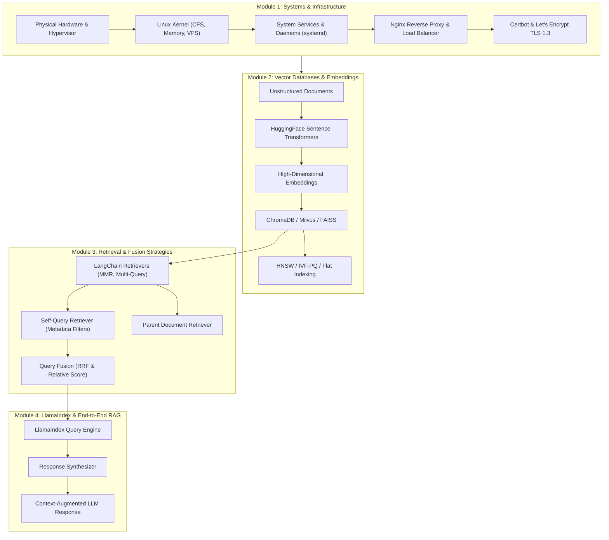

# Systems & AI Engineering Knowledge Base

[](https://kernel.org)
[](https://docker.com)
[](https://nginx.org)
[](https://trychroma.com)
[](https://python.langchain.com)
[](https://llamaindex.ai)

A structured, end-to-end reference and learning repository bridging **DevOps & Linux System Administration** with **Generative AI & Modern Information Retrieval (RAG, Vector Databases, LangChain, and LlamaIndex)**.

---

## 🗺️ System & AI Architecture Roadmap

The following diagram illustrates how low-level operating system daemons and networking form the reliable foundation for scalable AI vector stores, hybrid retrievers, and LLM-powered context augmentation:



---

## 📚 Complete Learning Roadmap & Documentation

The guides are organized sequentially under the [`docs/`](./docs) directory:

### 🐧 [01. Linux & DevOps](./docs/01-linux-and-devops/)
Foundational systems knowledge for deploying and operating AI servers:
- **[01-kernel-and-virtualization.md](./docs/01-linux-and-devops/01-kernel-and-virtualization.md)**:
  - Linux kernel vs. Operating System distinctions.
  - Core subsystems: CPU scheduling (CFS), memory management, storage abstraction (VFS).
  - Virtualization, Hypervisor architectures (Type 1 vs. Type 2), and resource partitioning.
- **[02-system-administration-and-nginx.md](./docs/01-linux-and-devops/02-system-administration-and-nginx.md)**:
  - Filesystem hierarchy (`/bin`, `/etc`, `/var`, `/tmp`, `/home`).
  - Permissions & user access control (`chmod`, `chown`, `sudo`, `useradd`).
  - Process monitoring and `systemd` service automation (`systemctl`).
  - Shell variables, archiving (`tar`, `gzip`), and scheduled jobs (`cron`).
  - Production Nginx setup: reverse proxying, upstream load balancing, and location blocks.
  - Automated SSL/TLS encryption with Certbot, Let's Encrypt, HTTP-to-HTTPS redirect, and HSTS.

### 📐 [02. Vector Databases & Embeddings](./docs/02-vector-databases/)
Theoretical and practical foundations of semantic search:
- **[01-vector-databases-and-chromadb.md](./docs/02-vector-databases/01-vector-databases-and-chromadb.md)**:
  - Multi-dimensional vector math and similarity metrics (Cosine, Euclidean, Dot Product).
  - Database topologies: In-memory, disk-based, distributed, and graph-based vector DBs.
  - Dedicated search engines (Pinecone, Weaviate, Milvus) vs. relational extensions (`pgvector`).
  - ChromaDB deployment architectures (in-process vs. client-server).
  - Hands-on operations: collections, SentenceTransformer embeddings, and filtered querying (`$and`, `$or`, `$eq`, `$in`, `$contains`).

### 🔗 [03. LangChain & Advanced Retrievers](./docs/03-langchain-and-retrievers/)
Sophisticated document retrieval pipelines for RAG:
- **[01-advanced-retrievers-and-fusion.md](./docs/03-langchain-and-retrievers/01-advanced-retrievers-and-fusion.md)**:
  - Vector-store retrievers and Maximal Marginal Relevance (MMR) for diversity.
  - Multi-Query Retriever for semantic query variations.
  - Self-Query Retriever: converting natural queries into semantic text + metadata schemas.
  - Parent Document Retriever: resolving the chunking dilemma by retrieving parent context from child embeddings.
  - Keyword ranking (TF-IDF vs. BM25 saturation), Auto-Merging, and Recursive Retrievers.
  - Rank fusion strategies: Reciprocal Rank Fusion (RRF) and Relative Score Fusion.
- **[02-faiss-indexing-and-milvus.md](./docs/03-langchain-and-retrievers/02-faiss-indexing-and-milvus.md)**:
  - FAISS (Facebook AI Similarity Search) vs. ChromaDB comparison.
  - Indexing algorithms: Flat Index, Inverted-File Index (IVF), Locality-Sensitive Hashing (LSH), and Hierarchical Navigable Small World (HNSW).
  - Scaling FAISS horizontally and adding metadata support via Milvus.

### 🦙 [04. LlamaIndex & Query Engines](./docs/04-llamaindex/)
Context augmentation and synthesis workflows:
- **[01-document-loaders-and-chunking.md](./docs/04-llamaindex/01-document-loaders-and-chunking.md)**:
  - `Document` objects and connectors (`SimpleDirectoryReader`).
  - Chunking strategies into `Node` objects with `SentenceSplitter` and `LangchainNodeParser`.
- **[02-vector-storage-and-rag.md](./docs/04-llamaindex/02-vector-storage-and-rag.md)**:
  - Vector indexing with `VectorStoreIndex`.
  - Custom Hugging Face embeddings (`sentence-transformers/all-MiniLM-L6-v2`).
  - Persistent ChromaDB vector storage via `ChromaVectorStore` and `StorageContext`.
  - Similarity retrieval (`as_retriever`) and response generation (`ResponseSynthesizer`).
  - All-in-one RAG pipeline with `as_query_engine()`.

---

## ⚡ Handy Quick-Reference Cheatsheet

### 1. Linux & Service Management
```bash
# Check service status and control daemons
sudo systemctl status nginx
sudo systemctl restart nginx
sudo systemctl enable --now nginx

# Inspect listening ports and active processes
sudo ss -tulpn | grep :80
ps aux | grep python

# Monitor disk usage and directory sizes
df -h
du -sh /var/log/* | sort -hr | head -n 5

# Create a compressed tar archive
tar -czvf backup_$(date +%F).tar.gz /path/to/data/
```

### 2. Nginx Reverse Proxy with SSL
```nginx
server {
    listen 80;
    server_name api.yourdomain.com;
    return 301 https://$host$request_uri;
}

server {
    listen 443 ssl http2;
    server_name api.yourdomain.com;

    ssl_certificate /etc/letsencrypt/live/api.yourdomain.com/fullchain.pem;
    ssl_certificate_key /etc/letsencrypt/live/api.yourdomain.com/privkey.pem;
    ssl_protocols TLSv1.2 TLSv1.3;

    location / {
        proxy_pass http://127.0.0.1:8000;
        proxy_set_header Host $host;
        proxy_set_header X-Real-IP $remote_addr;
        proxy_set_header X-Forwarded-For $proxy_add_x_forwarded_for;
    }
}
```

### 3. ChromaDB Python Querying
```python
import chromadb
from chromadb.utils import embedding_functions

# Connect and initialize embedding function
client = chromadb.PersistentClient(path="./chroma_db")
ef = embedding_functions.SentenceTransformerEmbeddingFunction(model_name="all-MiniLM-L6-v2")

# Create collection
collection = client.get_or_create_collection(name="knowledge_base", embedding_function=ef)

# Add records
collection.add(
    documents=["LangChain enables composable LLM chains", "ChromaDB provides fast vector lookups"],
    metadatas=[{"category": "framework", "version": 0.2}, {"category": "database", "version": 0.4}],
    ids=["doc1", "doc2"]
)

# Semantic search with metadata filter
results = collection.query(
    query_texts=["How to search vectors?"],
    n_results=2,
    where={"category": {"$eq": "database"}}
)
```

### 4. LangChain Parent Document Retriever
```python
from langchain.retrievers import ParentDocumentRetriever
from langchain_community.vectorstores import Chroma
from langchain_community.embeddings import HuggingFaceEmbeddings
from langchain.text_splitter import RecursiveCharacterTextSplitter
from langchain.storage import InMemoryStore

# Splitters: large parent chunks for context, small child chunks for precise embeddings
parent_splitter = RecursiveCharacterTextSplitter(chunk_size=2000, chunk_overlap=100)
child_splitter = RecursiveCharacterTextSplitter(chunk_size=400, chunk_overlap=50)

vectorstore = Chroma(collection_name="parent_chunks", embedding_function=HuggingFaceEmbeddings())
docstore = InMemoryStore()

retriever = ParentDocumentRetriever(
    vectorstore=vectorstore,
    docstore=docstore,
    child_splitter=child_splitter,
    parent_splitter=parent_splitter
)
```

### 5. LlamaIndex End-to-End Query Engine
```python
import chromadb
from llama_index.core import SimpleDirectoryReader, VectorStoreIndex, StorageContext
from llama_index.vector_stores.chroma import ChromaVectorStore
from llama_index.embeddings.huggingface import HuggingFaceEmbedding

# 1. Ingest documents
documents = SimpleDirectoryReader("./data").load_data()

# 2. Setup persistent Chroma storage
db = chromadb.PersistentClient(path="./chroma_llama")
chroma_collection = db.get_or_create_collection("llama_collection")
vector_store = ChromaVectorStore(chroma_collection=chroma_collection)
storage_context = StorageContext.from_defaults(vector_store=vector_store)

# 3. Create index with custom embeddings
embed_model = HuggingFaceEmbedding(model_name="sentence-transformers/all-MiniLM-L6-v2")
index = VectorStoreIndex.from_documents(
    documents,
    storage_context=storage_context,
    embed_model=embed_model
)

# 4. Query engine execution
query_engine = index.as_query_engine(similarity_top_k=3)
response = query_engine.query("Explain the difference between IVF and HNSW indexing.")
print(str(response))
```

---

## 📂 Repository Directory Layout

```text
.
├── .agents/                                # Workspace automation & agent rules
├── .gitignore                              # Git exclusion rules (OS, Python, DB caches)
├── .markdownlint.json                      # Markdown linting configuration
├── README.md                               # Repository portal & master guide
└── docs/
    ├── 01-linux-and-devops/
    │   ├── 01-kernel-and-virtualization.md # Linux architecture, CPU scheduling & hypervisors
    │   ├── 02-system-administration-and-nginx.md # System commands, systemd, Nginx & SSL/TLS
    │   └── images/                         # 51 architecture & terminal screenshots
    ├── 02-vector-databases/
    │   ├── 01-vector-databases-and-chromadb.md # Vector math, DB categories & ChromaDB
    │   └── images/                         # 33 vector space & Chroma query diagrams
    ├── 03-langchain-and-retrievers/
    │   ├── 01-advanced-retrievers-and-fusion.md # MMR, Multi-query, Parent-doc & Rank fusion
    │   ├── 02-faiss-indexing-and-milvus.md # FAISS index types (IVF, HNSW) & Milvus
    │   └── images/                         # 8 retrieval workflow diagrams
    └── 04-llamaindex/
        ├── 01-document-loaders-and-chunking.md # Document loading & node parsers
        ├── 02-vector-storage-and-rag.md    # Indexing, storage context & query engine
        └── images/                         # 5 LlamaIndex architecture diagrams
```

---

## 🛠️ Environment & Prerequisites

To run the Python code examples provided throughout the guides, set up a virtual environment:

```bash
# Create and activate virtual environment
python -m venv .venv
source .venv/bin/activate  # On Windows: .venv\Scripts\activate

# Install core packages
pip install chromadb llama-index langchain sentence-transformers
```

---

## 🤝 Contributing & License

Feel free to expand on these notes by submitting pull requests or opening issues. All materials are open for personal and community learning.
