# Linux System Administration, Services & Nginx Web Server

A comprehensive, hands-on guide covering the Linux directory hierarchy, essential commands, user and group security, systemd daemons, scheduled tasks, archiving, Nginx reverse proxy configuration, and Let's Encrypt SSL/TLS deployment.

---

## Table of Contents

- [Filesystem Hierarchy & Directory Navigation](#commands)
- [User Relevant Commands](#user-relevant-commands)
- [Package Management (`apt`)](#package-management)
- [Users and Groups](#users-and-groups)
- [Processes and Services](#processes-and-services)
  - [Process Management (`ps`, `top`, `kill`)](#process)
  - [Services & Daemons](#service)
  - [systemd (`system daemon`)](#systemd---system-daemon)
  - [systemctl (`system control`)](#systemctl---system-control)
- [Environment Variables and Shell Variables](#environment-variables-and-shell-variables)
- [Archive and Compression (`tar`, `gzip`)](#archive-and-compression)
- [Scheduled Tasks & Cronjobs](#cronjob)
- [Filesystem Management](#file-system)
- [Nginx Web Server](#nginx)
- [SSL & HTTPS Security](#ssl)
  - [Let's Encrypt & Certbot](#certbot)
  - [NGINX SSL Configuration](#nginx-ssl-configuration)

---

## Commands

*In linux, everything starts with the root directory "/". In windows, it starts with the C:\ drive. or any other drive/partition e.g D:\ .*

*Home Directory* - */home/username or ~* - *This is the personal namespace for the current user {awais for say} - and awais has all the rights to do anything here, but not hashim can do anything here without having the escalated/sudo rights.*
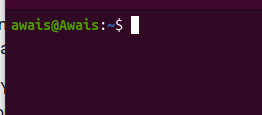

*System Territory* - *Directory /bin is for binary files, /etc is for configuration files, /usr is for user binaries and libraries, /var is for variable data and log files. /home is for home directories, /root is for the root user's home directory, /tmp is for temporary files, and /media is for mounted media devices*

*A user like awais or hashim can have a look there, but to make changes (write, update, delete, etc) in the system files - {other than the /home/{username} or /tmp} - you need to have the escalated/sudo rights*
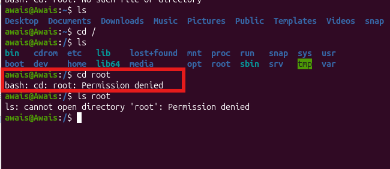

**Root Directory** - *"/" is the top level directory of the linux based operating systems.*
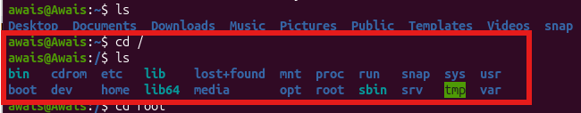

**Root User/Administrator** - */root is the personal namespace for the root user/administrator. because of this no normal user is allowed to peek into this directory and thus causes a denied permission errors*

**sudo** - *Superuser do* - *It only works and elevates the permisiion for the execution of the programs, 'things it can grab and run as the admin privileged program'*

**pwd** - print working directory
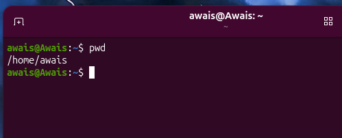

**cd** - change directory

    == move around the directory/folder (in windows) "cd {folder name}"
    == {./ -> current directory, ../ -> parent directory, / -> root directory }

* you might notice that you can't 'cd' into the root user directories or things not privileged for yet - for those you need the escalated rights

* To do so. write
```bash
sudo -i
```
* This raises the terminal you're in currently to admin privileged. changing the $ to # on the user prompt
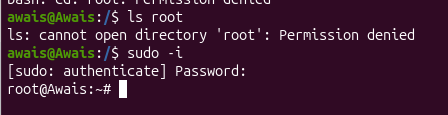
* You can exit by simply writing 'exit'
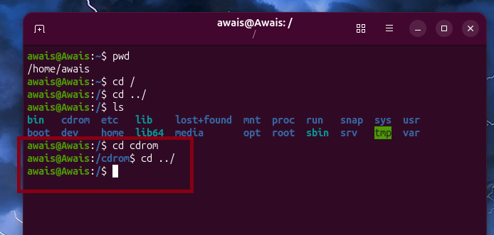
**ls** - list

    == list the files and folders present in the current directory or specified directory
    == Use ls -a to show hidden files
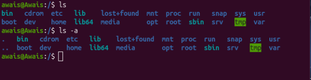

**mkdir** - make directory

    == create a directory 'mkdir {directory name}'
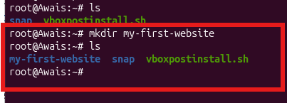

**mkdir -p {directory name/path}** - *This is used to make nested directories (a parent directory, sub directory and it's subdirectory ..) in one go*
*mkdir -p my/Nested/sub/Subdirectory*

**touch** - touch

    == use to create a file {e.g. for code, scripts, config, docs, etc}
    == 'touch file.txt' will create a new file named file.txt
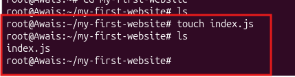

**vim** - *text editor*
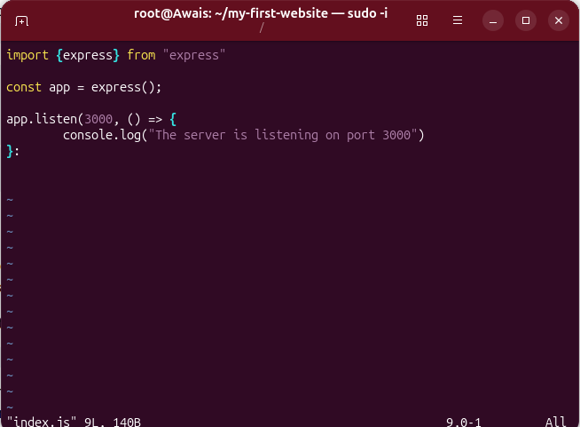

**cp** - copy

    == copies the files from *source* to *destination*
    == cp {source} {destination}
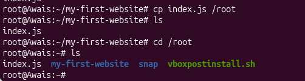

**cat**

    == concatenate - link, read, view files
    == it reads the content from one file location and 'prints' it out, showing it on the terminal
    == might also link link multiple files (concatenate their inner content by reading it) and then 'prints/streams' it out
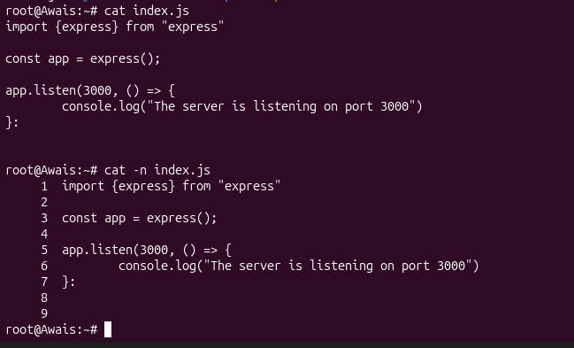

```Some information
Each linux program starts with three standard data channels (streams)

    - stdin (standard input): Where programs listen for data (default: keystrokes from keyboard)
    - stdout (standard output): Where programs send normal output(default: Terminal Screen)
    - stderr (standard error): Where programs send error messages(defult: Terminal Screen)

    cat is one of those commands that read from stdin and write to stdout. so basically, by default, cat reads from the keyboard and prints to the terminal, but we can redirect both of these streams to file or somewhere else.

cat {file.txt} - reads data from the file and shows it on terminal
cat {file.txt} > {new_file.txt} - reads data from file.txt and writes it to new_file.txt (overwrites if exists)
cat {file.txt} >> {new_file.txt} - reads data from file.txt and appends it to new_file.txt (creates if not exists)
cat {file.txt} {file2.txt} {file3.txt} > {combined.txt} - reads data from file.txt, file2.txt, file3.txt and writes it to combined.txt (overwrites if exists)
cat {file.txt} {file2.txt} {file3.txt} >> {combined.txt} - reads data from file.txt, file2.txt, file3.txt and appends it to combined.txt (creates if not exists)

cat reads files sequentially and writes them to the output stream sequentially as well, using a small space known as buffer.


```

**less** - *text viewer, using pagination {forward or backward} to navigate through files*

    == to use less on a file -> "less {filename}"
    == 'q' to quit
    == 'f' to move forward
    == 'b' to move backward
    == to search a specific word - /{word}

**clear**

    == to clear the terminal 

**history**

    == to look your command history of the terminal
    == also works with arror up

*To navigate to the specific user directory - use 'Tilde (~)'*
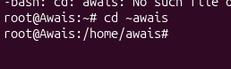

*./ referes to the current directory*

*../ refers to the directory parent*

*../../ refers to the directory parent's parent directory. {grandparentDirectory/parent/directory}*

### User Relevant Commands

*whoami* -- tell's the user you're currently logged in as

*adduser* - use to add a new username to the system

    == sudo adduser <username>
    
*sudo passwd {username}* - use to set password for a specific user

    == can do it directly if you're the superadmin

*id* - gives you the user ID and groups

    == id {username}

*su* - switch user

    == 'su' -> switches to the root user 'no paramteric'
    == 'su {options} {username}' -> switches to the specified user
    == 'su - {options} {username}' -> '-' is used for the logged in terminal session. meaning the user environment, paths, application, and variables are all shifted to the *new user*
    == *if you use the non hyphened 'su' then you will keep the previos user variables and profiles, and some applications might not be loaded of the user user.*

*w* - get all the logged in users
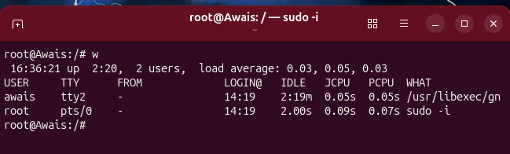

* *all users details are stored in the /etc/passwd file*
* *if a new user doesn't have the access rights of a sudo user then they can't sudo or run any app with prvivileged access*
* 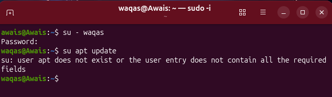
* *linux creates a new directory in the /home directory for all the users*
* 

* *----------------Provide sudo permissions to a user---------------*

1. switch to root user profile

**usermod** - user modify

    == system administrators to modify the attributes of an existing user account
    == updates the critical files '/etc/passwd' and 'etc/group', always execute it with root or sudo privileges

    == sudo usermod -l {newname} {oldname} -> renames a user login
    == sudo usermod -aG {groupname} {username} -> adds a user to a secondary group without modifying/removing it from it's previos groups
    == sudo usermod -d {/new/path} -m {username} -> changes the home directory of the user and moves the existing files to it
    == sudo usermod -s {/bin/bash} {username} -> changes the user's defult login shell
    == sudo usermod -L {username} -> Locks a user account (disable login)
    == sudo usermod -U username -> Unlocks a locked user account

* sudo usermod -aG sudo waqas
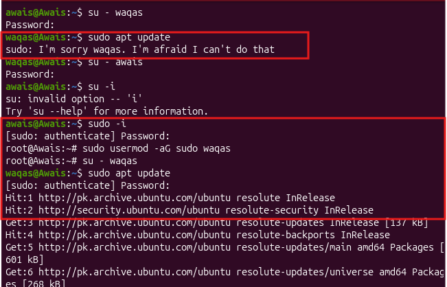

### Package Management

**apt** - advanced package tool

    == used to install, update, upgrade, and remove packages
    == syntax: sudo apt {action} {package name}

        * install -> 'sudo apt install {package name}'
        * update -> 'sudo apt update' (refreshes the list of package locations from the repositories)
        * upgrade -> 'sudo apt upgrade' (installs newer versions of all packages currently installed on the system)
        * remove -> 'sudo apt remove {package name}' (uninstalls the package but keeps config files)
        * purge -> 'sudo apt purge {package name}' (uninstalls the package and removes config files)
        * autoremove -> 'sudo apt autoremove' (removes packages that were automatically installed to satisfy dependencies for other packages and are no longer needed)
        * search -> 'sudo apt search {package name}' (searches for packages that match the given string)
        * show -> 'sudo apt show {package name}' (shows detailed information about a package)
        * list -> 'sudo apt list' (lists all available packages)
        * full-upgrade -> 'sudo apt full-upgrade' (upgrades the system, but also removes packages if necessary to resolve dependency conflicts)
        * edit-sources -> 'sudo apt edit-sources' (opens the sources.list file in a text editor to allow manual editing of the repositories)

### Users and Groups

**addgroup** - *used to add a new group to the system*

    == sudo groupadd {groupname}
    
    == sudo groupadd app-developers

    == once the group is added, we move to the group directory and add the users that we have in our system to the group

**useradd** - *used to add a new user to the system*

    == 'useradd' vs 'adduser'

    == works same as "adduser" but needs precise flags for user creation. means more work to do. the new command is linux default and low level, but the previous "adduser" is a wrapper around it.

    == sudo useradd -m {username} (creates a locked user account)

    == sudo passwd {username} (set's the user password)

**usermod** - user modify

    == sudo usermod -aG {groupname} {username}

*ls -l* - *list long*

    == displays the list of directories and detailed information with user rights and many parameters.

    == file permisions, links, owner, group, file size, modification time, filename
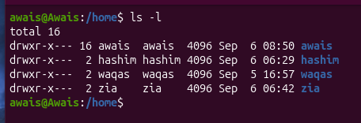

drwxr-x-- 16 awais 4096 Sep  6 08:50 awais

at index:
0: '-' means a simple file, and 'd' means it is a directory
1-3 (rwx) (owner): r -> read, w -> write, x -> execute/run
4-6 (r-x) (group): r -> read, w -> write, x -> execute/run
7-9 (r--) (others): r -> read, w -> write, x -> execute/run
10 (16): '16' links points to this file. for directories, it means the number of subdirectories
11 (awais): group to which it has shared file access
12-15 (4096): how much space it takes
16-18 (Sep  6 08:50): exact date and time when the file was last edited
filename (awais): the actual name of the file or folder

**ch** - change used before many commands

    == chmod -> change modifiers to the file.
        == chmod {options/mode} {user+group+others}{filename/path}
        * *chmod {options} {file/path}*
            - example: chmod +rwx file.txt -> adds read, write and execute commands access to the current user.
            - example: chmod 755 file.txt -> same as above but in numeric format.
            - example: chmod 644 file.txt -> same as above but in numeric format.
                * syntax -> {ownership+modifier+permissions} {filename/path}
                    - ownership can be 'u' for user, 'g' for group, 'o' for others.
                    - modifier can be '+', '-', or '='
                    - permissions can be 'r' for read, 'w' for write, 'x' for execute/run
                        * 777 -> owner: rwx, group: rwx, others: rwx (fully open)
                        * 755 -> owner: rwx, group: r-x, others: r-x (executables and scripts)
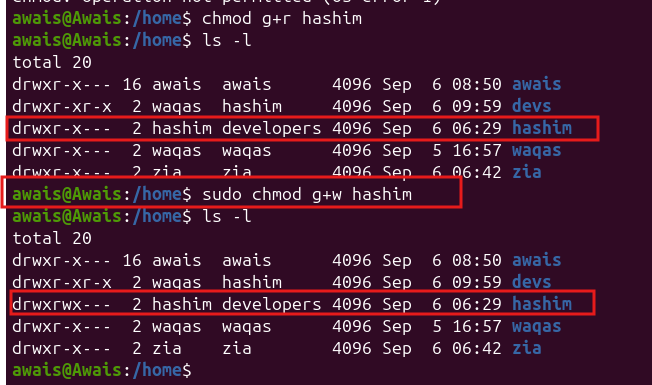

    == chown -> change ownership of the file.
        == chown {username} {filename/path}
        == chown -R {username} {directory/path} -> '-R' means recursively, all files/folders coming in the way (files in that path and their sub directories)
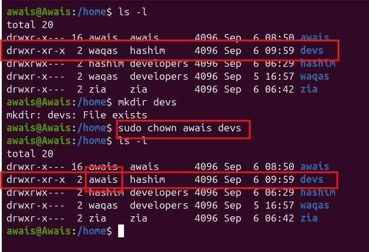

    == chgrp -> change group of the file.
        == chgrp {groupname} {filename/path}
        == chgrp -R {groupname} {directory/path} -> '-R' means recursively
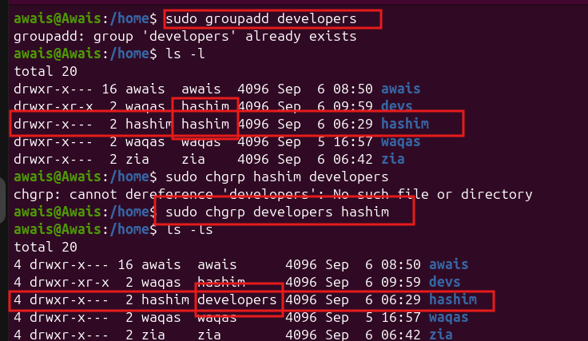

### Processes and Services

#### Process

*Process is a programme in execution*

**ps** - process status

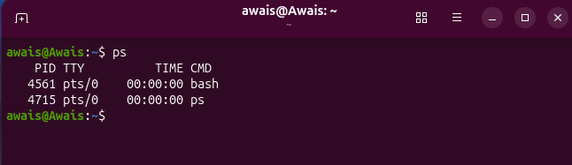

* *PID -> Process ID*
* *TTY -> Terminal associated with the process*
* *TIME -> CPU time consumed by the process*
* *CMD -> Command that started the process*
>
    == (default) -> select all the processes with same effective user id as the current user and associated with the same terminal as the invoker.
    == ps {options}
        = aux -> show all processes running
            == 'a' -> select all processes with a tty (terminal), and from all users not just the current one.
            == 'u' -> output format user-oriented
            == 'x' -> select processes that do not have a controlling terminal (like daemons and services)
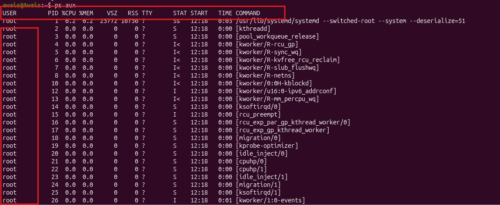

        == ef -> show all processes running in user-oriented format
            == 'e' -> select all processes
            == 'f' -> f for full format (shows UID, PPID, C, STIME, TTY, TIME, CMD)
        == ps -ef | grep {process name} -> search a specific process
        == ps -ef | grep -i {process name} -> search a specific process (case insensitive)

**top** - table of processes

    == returns the real time processes resource consumption in the the form of table (dynamic - updates automatically)
    == in top command, we can sort the processes by PID, CPU usage, Memory usage, etc.

**htop** - Hisham Muhammad top command -> similar to top but more user friendly and with more features

    == provides colorful realtime resouce usage by the processes rather than the bleak black and white table of top command.

**kill** - used to terminate a process

    == kill {PID}
    == kill -9 {PID} -> kills the process forcefully

**pkill** - used to terminate all processes with the same name

    == pkill python

**pstree** - process tree

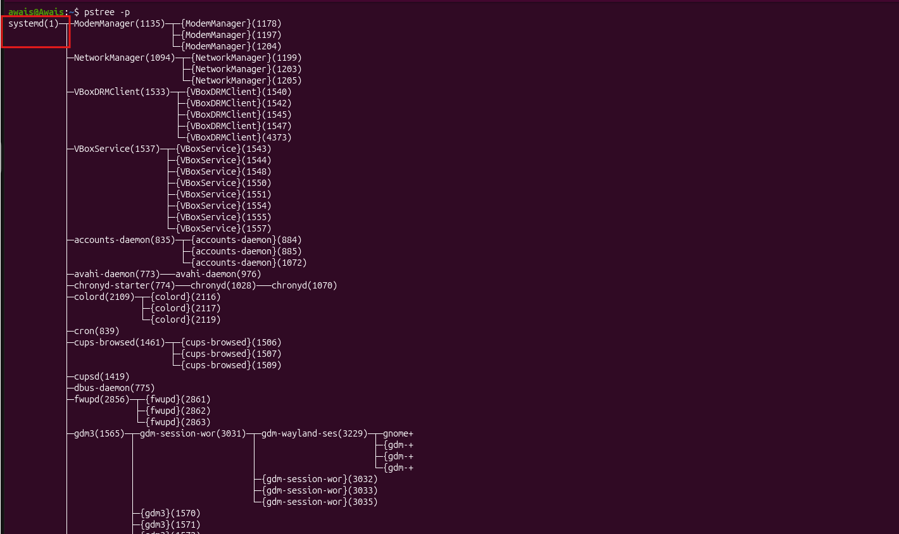

    == Main Process States
        == Running ( R ) -> process is currently running
        == Sleeping ( S ) -> process is sleeping
        == Stopped ( T ) -> process is stopped (by a signal like SIGSTOP or SIGINT)
        == Zombie ( Z ) -> process is zombie (orphan process)

#### Service

*a process that keeps running in the background (solves a specific cause/purpose)*

    == example
        * nginx service is running -> serves websites
        * mysql service is running -> manages databases

#### Daemon

*A process that runs persistently in the background and is independent of terminal references. (sometimes of user sessions as well)*

* Lack ( GUI ) and terminal reference -> user can not interact directly
* Sleep until triggered by an event, request, or timer through the operating system
* No reference bound to terminal or user session -> keeps running after they log out or are closed
  * Use the control utilities to interact with them e.g [systemctl](#systemctl---system-control)
  * Services like [apache](#), [mysql](#), [nginx](#), [ssh](#) are all daemons

##### systemd - system daemon

*Top level daemon in the hierarchy ( PID 1 )*

    == It is first process that is loaded by the kernel during the boot process
    == It is the parent of all other processes and takes over the responsibility of init process ( PID 1 )

    == It is responsible for running the user services and daemons, that are then necessary for running the system after it's initlization.

>systemd(1) -> parent process in the tree and all child processed (daemon and services) are running under it.

    == It is responsible for the management of the system to keep it running, restarting services (daemons) when they crash
    and stopping them when they are no longer needed
    == It is managing the highly parallelized startup of services to boot up the system faster, compared to the older systems
    == It is using Linux control groups (cgroups) and namespaces to isolate each service and manage its resources

    == It is managing services (daemons) in the form of Units
        ==  Services (daemon) unit - .service -> used for services/daemons
        ==  Mount unit - .mount -> used for mount points
        ==  Socket unit - .socket -> used for network sockets (listen for incoming traffic)
        ==  Target unit - .target -> used for grouping of units and providing compatibility with older [runlevels](#runlevels-legacy---for-reference-only)

##### systemctl - system control

*command-line utility to control systemd*

* **syntax:** `systemctl {options} {service name}`  
* **options:**  
  * **start** -> `sudo systemctl start {service name}`  
  * **stop** -> `sudo systemctl stop {service name}`  
  * **restart** -> `sudo systemctl restart {service name}`  
  * **reload** -> `sudo systemctl reload {service name}` -> reload the service configuration (does not restart the service)
  * **status** -> `sudo systemctl status {service name}`  
  * 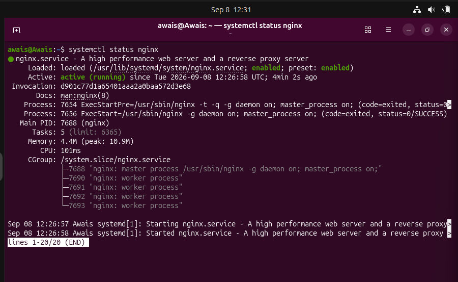
  * **enable** -> `sudo systemctl enable {service name}` (configure to start on the next boot)  
  * **disable** -> `sudo systemctl disable {service name}` (prevents the service from starting on next boot)  
  * **list-units** -> `systemctl list-units --type={types}`  
    * **types:**  
      * **service** -> system services / user services  
      * **socket** -> network sockets (listens for incoming network connections)  
      * **mount** -> filesystem mount points  
      * **target** -> groups of units 
      * **automount** -> automount points
      * **timer** -> timers
      * **path** -> path units
      * **snapshot** -> snapshot units
      * **swap** -> swap units
      * **scope** -> scope units
      * **device** -> device units
      * **slice** -> slice units
      * **bus** -> bus units
      * **mount** -> mount units
      * **target** -> target units

    == Examples:  
      * `sudo systemctl start nginx`  
      * 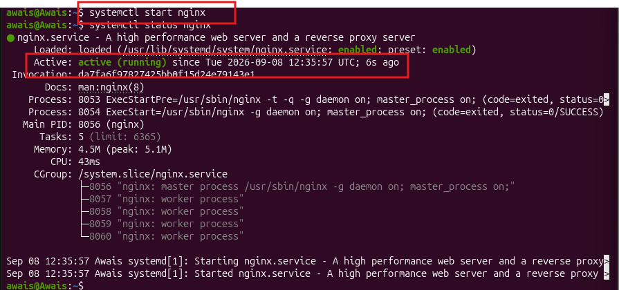
      * `sudo systemctl stop nginx`
      * 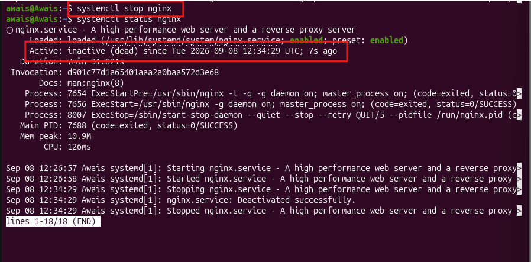
      * `sudo systemctl restart nginx` 
      * 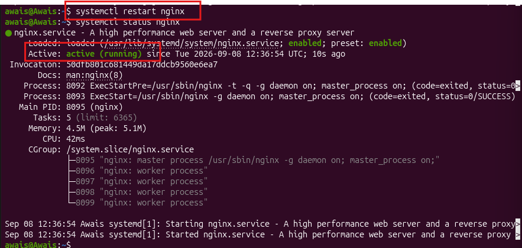 
      * `sudo systemctl status nginx`  
      * 
      * `sudo systemctl enable nginx`  
      * `sudo systemctl disable nginx`  
      * `systemctl list-units --type=service`  
      * `systemctl list-units --type=socket`  
      * `systemctl list-units --type=mount`  
      * `systemctl list-units --type=target`  
      * `systemctl list-units --type=automount`  
      * `systemctl list-units --type=timer`  
      * `systemctl list-units --type=path`  
      * `systemctl list-units --type=snapshot`  
      * `systemctl list-units --type=swap`  
      * `systemctl list-units --type=scope`  
      * `systemctl list-units --type=device`  
      * `systemctl list-units --type=slice`  

### Environment Variables and Shell Variables

**Environment Variables**: *Key values that contain system-specific configuration and settings values to determine behavior of operating system.*

* 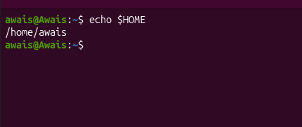
*p.s -> '${VARIABLE_NAME}' is used to access the value of the environment variable and it is called as 'Variable Substitution'.*

* Available globally to all the processes and the shells and it has system wide impact
* UPPER CASE by convention
* Syntax: `export VARIABLE_NAME="value"` (also rewrites the value if already present)
* Unset: `unset VARIABLE_NAME`
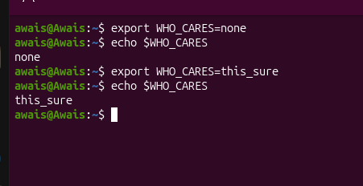

**printenv** - print all variables that are accessible to the shell. (environment + shell)
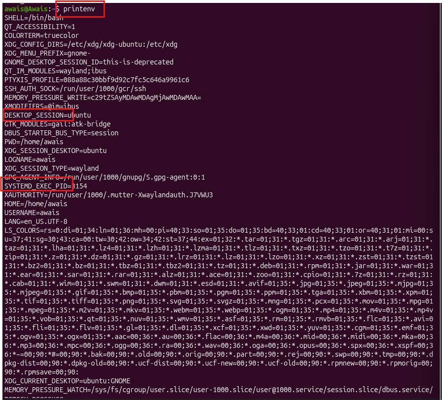

**$PATH** - *any executable file that is present the list of directories in this variable will be executed directly without need to provide the absolute path of the file (for e.g $PATH = '/usr/local/bin' so we can execute '/usr/local/bin/ls' just by typing 'ls').*
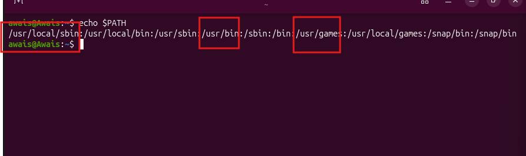

* To append a directory to the '$PATH' variable: `export PATH="/new/directory:$PATH"`  
* To prepend a directory to the '$PATH' variable: `export PATH="$PATH:/new/directory"`  
* To remove a directory from the '$PATH' variable: `export PATH="${PATH//\/new\/directory:}"`  

**Shell Variables**: Key values that are shell-specific and can't be accessed by any other shell (or any other process)

* Syntax: `VARIABLE_NAME="value"`

* Environment Variables are useful for defining the behavior of applications, scripts and the system itself. 
* **application** - based on the '$USERNAME' and '$HOME', applications know which user is currently logged in and what is the home directory of that user respectively
* **script** - based on the '$SHELL', scripts know which shell is being used to execute them
* **system** - based on the '$NAME' variable, user can identify if the OS is Red Hat

* **which** - to find the location/absolute path of the executable
* 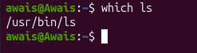
* **type** - to find the type of the executable
* 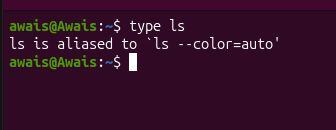
* **whereis** - to find the location of the executable, source code and the manual page
* 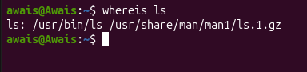

### Archive and Compression

*Archieving - inserting a collection of files in container to make it a one file*
(not necessary reducing the file size)

*Compression - reducing the file size of the file(s)*

#### Archive

##### tar

*file format and utility to create archives (collection of files)*

* Syntax: `tar {options} {archive name} {files}`
* Options:
  * **c** - create archive
  * **x** - extract archive
  * **t** - list archive (list down the contents of the archive without extracting it or modifying it)
  * **f** - file (path of the folder where to create/extract)
  * **v** - verbose (track the files which have been archived or extracted)
  * **z** - gzip compression (compress using the gzip compression technique)
  * **j** - bzip2 compression (compress using the bzip2 compression technique)
  * **J** - xz compression (compress using the xz compression technique)
* Examples:
  * `tar -cvf archive.tar file1 file2 file3` - *create archive, verboes, file*
  * 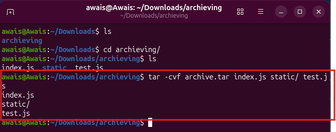
  * `tar -cvf archive.tar *.txt` - *create archive, verbose, and incluse all files of txt extension in the folder*
  * `tar -xvf archive.tar` - *extract archive, verbose, and file*
  * `tar -tvf archive.tar` - *list archive content (files and directories inside the archive) in detail (like ls -l) but only for the archive*
  * 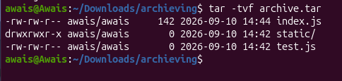
  * `tar -czvf archive.tar.gz file1 file2 file3` *create the archive, use gzip compression, verbose, and file (to store the compressed archive)*
  * `tar -zxvf archive.tar.gz` - *extract the archive, use gzip compression, verbose, and file (to extract the compressed archive)*
  * `tar -tvvf archive.tar.gz` - *list archive content (files and directories inside the archive) in detail (like ls -l) but only for the archive*
  * `tar -cjf archive.tar.bz2 file1 file2 file3` - *create the archive, use bzip2 compression, verbose, and file (to store the compressed archive)*
  * `tar -xjvf archive.tar.bz2` - *extract the archive, use bzip2 compression, verbose, and file (to extract the compressed archive)*
  * `tar -tvvf archive.tar.bz2` - *list archive content (files and directories inside the archive) in detail (like ls -l) but only for the archive*
  * `tar -cJvf archive.tar.xz file1 file2 file3` - *create the archive, use xz compression, verbose, and file (to store the compressed archive)*
  * `tar -xJvf archive.tar.xz`
  * `tar -tvvf archive.tar.xz`
  * `tar -zxvf archive.tar.gz` - *extract the archive, use gzip compression, verbose, and file (to extract the compressed archive)*
  * `tar -jxvf archive.tar.bz2` - *extract the archive, use bzip2 compression, verbose, and file (to extract the compressed archive)*
  * `tar -Jxvf archive.tar.xz` - *extract the archive, use xz compression, verbose, and file (to extract the compressed archive)*


**rm -rf** - *deletes the directory and all the subdirectories and files in it*

##### gzip

*utility to compress and decompress files*

> **NOTE:**
> * If you do not use the **-k** option (keep original file) the original file will be deleted after the compression/decompression
> 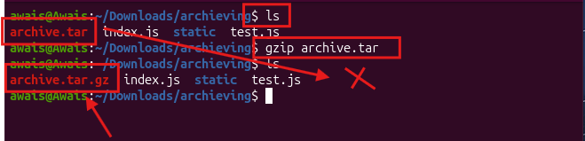
> * **gzip** is used to compress files (not archive)
> * **gunzip** is used to decompress files (not extract)

* Syntax: `gzip {options} {file name}`
* Options:
  * **c** - create archive
  * **x** - extract archive
  * **t** - list archive (list down the contents of the archive without extracting it or modifying it)
  * **f** - file (path of the folder where to create/extract)
  * **v** - verbose (track the files which have been archived or extracted)
  * **z** - gzip compression (compress using the gzip compression technique)
  * **j** - bzip2 compression (compress using the bzip2 compression technique)
  * **J** - xz compression (compress using the xz compression technique)
* Examples:
  * `gzip file1 file2 file3` - *create archive, verboes, file*
  * 
  * `gzip *.txt` - *create archive, verbose, and incluse all files of txt extension in the folder*
  * `gunzip archive.tar.gz` - *extract archive, verbose, and file*
  * `gzip -tvf archive.tar.gz` - *list archive content (files and directories inside the archive) in detail (like ls -l) but only for the archive*
  * 
  * `gzip -tzvf archive.tar.gz` *create the archive, use gzip compression, verbose, and file (to store the compressed archive)*
  * `gunzip -zxvf archive.tar.gz` - *extract the archive, use gzip compression, verbose, and file (to extract the compressed archive)*
  * `gzip -tvvf archive.tar.gz` - *list archive content (files and directories inside the archive) in detail (like ls -l) but only for the archive*
  * `gzip -cjvf archive.tar.bz2 file1 file2 file3` - *create the archive, use bzip2 compression, verbose, and file (to store the compressed archive)*
  * `gunzip -xjvf archive.tar.bz2` - *extract the archive, use bzip2 compression, verbose, and file (to extract the compressed archive)*

> **Notes**
> *gzip and bzip2 are used to compress files*
>
> *tar is used to archive files*
>
> *gzip and bzip2 can be used to compress archive files (when used with tar)*
>
> *gzip is faster than bzip2*
>
> *bzip2 is more efficient than gzip*
>
> *xz is more efficient than bzip2*
>
> *xz is slower than bzip2*
>
> *xz is slower than gzip*

### Cronjob

*To execute tasks periodically*

**Cron daemon** - *service used to execute tasks periodically - is already running and is not recommended to be stopped*
* Service running in the linux
* 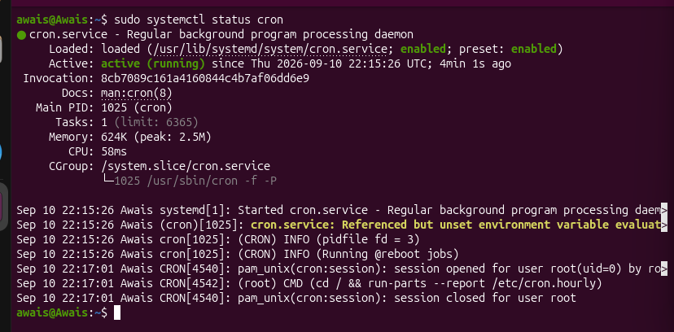
* `systemctl {options} cron`
* `systemctl status cron` - *to check the status of the cron daemon*
* `systemctl start cron` - *to start the cron daemon*
* `systemctl stop cron` - *to stop the cron daemon*
* `systemctl restart cron` - *to restart the cron daemon*
* `systemctl enable cron` - *to enable the cron daemon*
* `systemctl disable cron` - *to disable the cron daemon*

**Crontab** - *file which stores the cron job entries*
* No tabs present in the user directory (~)
* 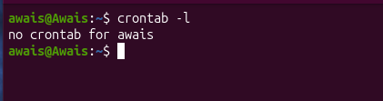
* **System Crontab** - `/etc/crontab` (entries in this file are executed by root user)
* 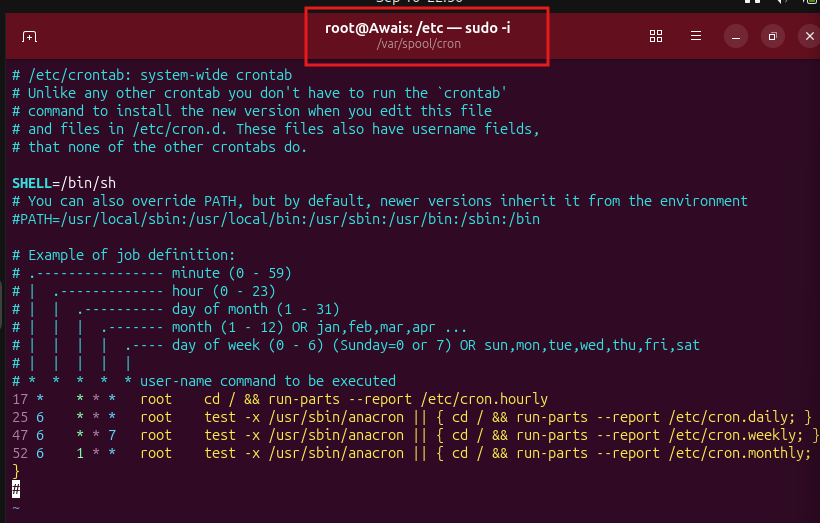
* **User Crontab** - `/var/spool/cron/crontabs/{username}` (entries in this file are executed by the user who owns the file)

**Cronjob** - *entry in the crontab file which specifies the task to be executed periodically*
* `crontab {options}`
* `crontab -e` - *to edit the crontab file*
* `crontab -l` - *to list the cron jobs*
* `crontab -r` - *to remove the cron jobs*
* `crontab -i` - *to remove the cron jobs interactively*
* `crontab -u {username}` - *to edit the crontab file of a specific user*
* `crontab -u {username} -l` - *to list the cron jobs of a specific user*
* `crontab -u {username} -r` - *to remove the cron jobs of a specific user*
* `crontab -u {username} -i` - *to remove the cron jobs interactively*

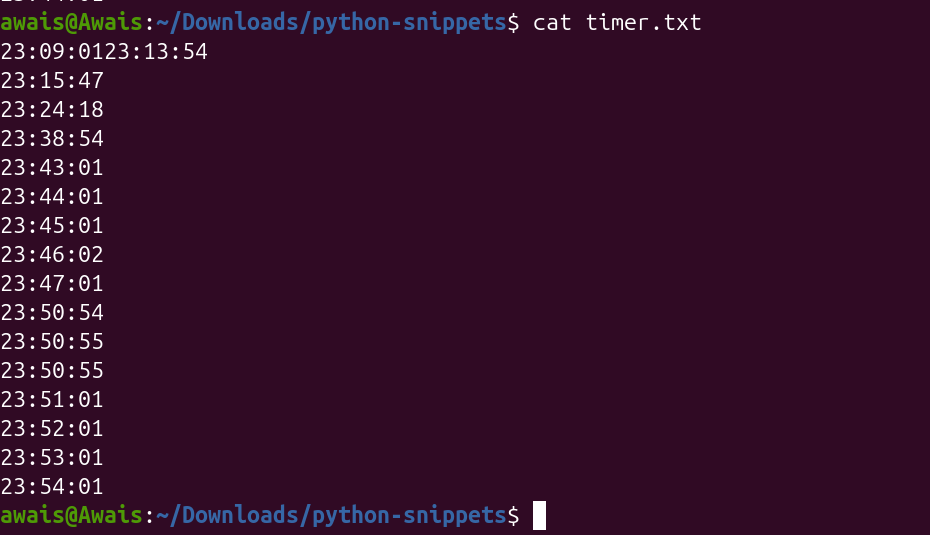
> **Note:**
> * The syntax of a cronjob is as follows:
> * Minute (0-59)
> * Hour (0-23)
> * Day of month (1-31)
> * Month (1-12)
> * Day of week (0-7)

### File System

* **/** - outer most directory
* **/root** - root user directory
  * `ls root` - *list the contents of the root directory*
  * `ls -a root` - *list the contents of the root directory in detail*
* **/home** - *home directory for all users (regular users)*
  * `ls home` - *list the contents of the home directory*
  * `ls -a home` - *list the contents of the home directory in detail*
  * `cd ~` - *move to your user's home directory*
* **/etc** - *system wide configuration files*
  * *CentOS/Ubuntu:* `/etc/passwd`, `/etc/shadow` (user credentials), `/etc/sudoers` (sudo access), `/etc/hosts` (DNS mappings), `/etc/ssh/sshd_config` (SSH server config). `/etc/hostname` - *hostname of the system*
* **/var** - *variable data files*
  * */var/log/* - *log files*
  * */var/lib/* - *database files*
  * */var/cache/* - *cache files*
  * */var/tmp/* - *temporary files*
  * */var/www/* - *web server files*
* **/usr** - *unix system resources*
  * */usr/bin/* - *binary files*
  * */usr/lib/* - *library files*
  * */usr/sbin/* - *system binary files*
  * */usr/share/* - *share files*
  * */usr/local/* - *local files*
* **/opt** - *optional software files*
  * */opt/bin/* - *binary files*
  * */opt/lib/* - *library files*
  * */opt/sbin/* - *system binary files*
  * */opt/share/* - *share files*
  * */opt/local/* - *local files*
* **/mnt** - *mount point for file systems*
  * **mount point** - *is a directory where the file system is mounted (in CentOS it is `/mnt/` but in ubuntu it is `/media/`)*
  * **mounting** - *is a process of making a file system available to the system.*
  * Example:
    * We have a hard disk with some files (partition)
    * When we plug it in the operating system will not show it to us
    * We need to mount (attach to the tree structure of the file management system of the OS) it to a directory
    * Then we can access the files


* **/tmp** - *temporary files*
* **/boot** - *boot loader files*
* **/dev** - *device files*
* **/proc** - *process files*

### Nginx

*Nginx is a*
> **Web server** - serves static files, data to the incoming requests
>
> **Application server** - serves dynamic files, data to the incoming requests
>
> **reverse proxy** - distribute incoming requests to the correct port/backend servers
>
> **Load balancer** - distribute incoming requests to the correct port/backend servers
>
> **HTTP cache** - cache the responses from the backend servers
>
> **SSL termination** - handle SSL/TLS encryption and decruption

* By default, nginx must be started by the root user privileges
  * It drops the privileges after startup and runs as a normal user (default nginx user) in the background
    * *Reason* - In Linux the ports below `1024` are restricted, and only root user is allowed to bind to them
  * In `nginx.conf` file we can see the `user` directive which specifies the user and group under which the nginx worker processes run
  * **Master process** - is the main process that manages the worker processes (runs as the root user to bind the incoming traffic to a port and assign the connections to the worker processes)
  * **Worker processes** - are the processes that handle the incoming requests (runs as the non-privileged user  www-data/nginx to handle the incoming requests)
    * Processes that actually talk to the internet, handle requests and work as per the configuration (so hacker can't run any malicious commands if the server is compromised/ is able to exploit the worker process)
* **Installation**
  * `sudo dnf install nginx` - *CentOS*
  * `sudo apt install nginx` - *Ubuntu*
  * 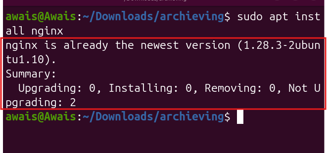
* **Configuration**
  * `sudo nano /etc/nginx/nginx.conf` - *CentOS*
  * `sudo nano /etc/nginx/nginx.conf` - *Ubuntu*
    * To find all the nginx related files use `whereis nginx`
    * 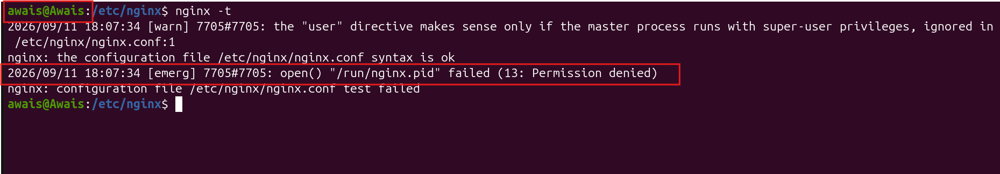
    * error: user is not allowed (error not displayed in screenshot)
* **Structure**
  * navigate to the `/etc/nginx/` directory 
  * 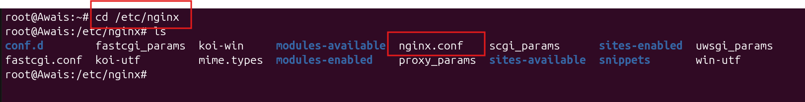
  * `sudo nano nginx.conf` - *main configuration file*
  * 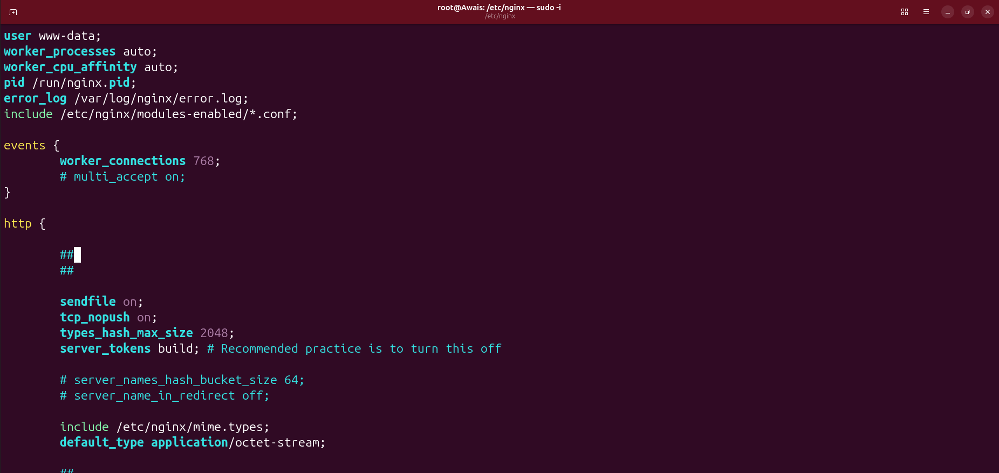
  * `nginx.conf` - (master configuration)
    * **Directive** - is a instruction to nginx to perform a specific action
    * **Block** - is a group of directives that are related to each other (enclosed in `{}`)
      * **user directive** - *Defines the user and group for the worker processes*
        * Example:
          * `user www-data` - *worker processes will run as www-data user (default for Ubuntu)*
          * `user www-data;` - *semicolon at the end of the directive*
          * `user nginx;` - *worker processes will run as nginx user (default for CentOS)*

      * **worker_processes** - *how many worker processes to run to handle incoming requests (By default it is set to 'auto')*
        * Example:
          * `worker_processes 1` - *single core CPU*
          * `worker_processes 2` - *dual core CPU*
          * `worker_processes 4` - *quad core CPU*
          * `worker_processes auto` - *automatically set the number of worker processes to the number of CPU cores*

      * **worker_cpu_affinity** - *affixes worker processes to a specific core (used to optimize performance by pinning processes to cores)*
        * Example:
          * `worker_cpu_affinity auto` - *automatically binds the worker processes to the available CPU cores*
          * `worker_cpu_affinity 0` - *binds the worker process to the first core*
          * `worker_cpu_affinity 0 1` - *binds the worker processes to the first two cores*
          * `worker_cpu_affinity 0 1 2 3` - *binds the worker processes to the first four cores*
          * `worker_cpu_affinity auto;` - *semicolon at the end of the directive*
      * **pid** - *path where the pid of the master process will be stored*

        * Example:
          * `pid /run/nginx.pid;` - *pid will be stored in `/run/nginx.pid`*
          * `pid /var/run/nginx.pid;` - *pid will be stored in `/var/run/nginx.pid`*
          * `pid /var/run/nginx.pid;` - *semicolon at the end of the directive*
            * Why PID storage needs to be stored?
              * When system daemon starts nginx `systemctl start nginx` it launches a temporary foreground process.
              * This process is only responsible for reading the configuration and validating it for errors.
              * Nginx then immediately forks(clones itself) into the background and daemonizes (runs in the background)
              * The daemonized master process (now backgrounded) closes its STDIN, STDOUT, STDERR and detaches from the terminal
              * The new (backgrounded) master process saves its PID into the file `pid`
              * The backgrounded process stays alive indefinitely
              * systemctl stop nginx/start nginx/reload nginx/restart nginx commands read the pid from the file `pid` and send the appropriate signal to the master process
                * **worker processes** - pid is given to the master process and is saved in the master process memory (RAM) - **NOT IN ANY FILE**
      * **error log** - *path where the error log file will be stored*
        * Example:
          * `error_log /var/log/nginx/error.log;` - *error log will be stored in `/var/log/nginx/error.log`*
          * `error_log /var/log/nginx/error.log;` - *semicolon at the end of the directive*

      * **access log** - *path where the access log file will be stored*
        * Example:
          * `access_log /var/log/nginx/access.log;` - *access log will be stored in `/var/log/nginx/access.log`*
          * `access_log /var/log/nginx/access.log;` - *semicolon at the end of the directive*

      **include** - *used to include other predefined configuration files*
        * Example:
          * `include /etc/nginx/conf.d/*.conf;` - *include all files from `/etc/nginx/conf.d/*.conf` directory*
          * `include /etc/nginx/sites-enabled/*;` - *include all files from `/etc/nginx/sites-enabled/*` directory*
          * Why we need to include these files?
            * A single configuration file `nginx.conf` would be of 100s of lines, which would be difficult to manage and maintain
            * It makes sense to keep the configuration files organized by including them from different directories
            * Each directory can have its own configuration files for different purposes
            * This makes it easier for modular working (devs can have their own config files)
            * Also let's devs use multiple configuration (eg. multiple domain names / multiple sites / multiple microservices) without cluttering or rewritting them in a single file
            * when using include files, match the context to which any file is being imported. Else, it'll lead to error
              * Example:
                * `include /etc/nginx/conf.d/*.conf;` - *include all files from `/etc/nginx/conf.d/*.conf` directory (context: main/http)*
                * `include /etc/nginx/sites-enabled/*;` - *include all files from `/etc/nginx/sites-enabled/*` directory (context: http/server)

        * **Events Context**
          * **worker_connections** - *max number of simultaneous connections that a worker process can handle*
            * Example:
              * `worker_connections 1024;` - *each worker process can handle 1024 simultaneous connections*
              * `worker_connections 4096;` - *each worker process can handle 4096 simultaneous connections*
              * `worker_connections 8192;` - *each worker process can handle 8192 simultaneous connections*
            * Total connections = `worker_processes * worker_connections`
              * Example:
                * `worker_processes 2` * `worker_connections 1024` = `2048` total connections
                * `worker_processes 4` * `worker_connections 4096` = `16384` total connections
                * `worker_processes 8` * `worker_connections 8192` = `65536` total connections
              * For most use cases, `worker_connections` can be set to `1024` or `2048`

          * **multi_accept** - *enables multiple accept mode on the worker process (makes the worker process accept all new connections at once, rather than one at a time)*
            * Example:
              * `multi_accept off;` - *accept one connection at a time (default)*
              * `multi_accept on;` - *accept multiple connections at once (recommended for high-performance servers)*

          * **use** - *specifies the event-handling method to use for the worker process to talk to the OS kernel (used in Linux 2.6 kernel which supports epoll system call which is more efficient than select system call)
            * Example:
              * `use epoll;` - *use epoll system call (recommended for Linux 2.6 kernel and above)*
              * `use select;` - *use select system call (default, used in older Linux kernels)*
              * `use kqueue;` - *use kqueue system call (recommended for BSD-based systems like macOS)*

          * **epoll_events** - *sets the maximum number of events that can be processed at once by the epoll system call (used only when `use epoll` is specified)
            * Example:
              * `epoll_events 4096;` - *process 4096 events at once (recommended for high-performance servers)*
              * `epoll_events 1024;` - *process 1024 events at once (default)*

          * **worker_rlimit_nofile** - *sets the maximum number of file descriptors that a worker process can open (used only when `use epoll` is specified)
            * Example:
              * `worker_rlimit_nofile 4096;` - *worker process can open 4096 file descriptors (recommended for high-performance servers)*
              * `worker_rlimit_nofile 1024;` - *worker process can open 1024 file descriptors (default)*

          * **kqueue_changes** - *sets the maximum number of events that can be registered with kqueue at once (used only when `use kqueue` is specified)
            * Example:
              * `kqueue_changes 4096;` - *register 4096 events at once (recommended for high-performance servers)*
              * `kqueue_changes 1024;` - *register 1024 events at once (default)*

          * **kqueue_events** - *sets the maximum number of events that can be processed at once by kqueue (used only when `use kqueue` is specified)
            * `kqueue_events 4096;` - *process 4096 events at once (recommended for high-performance servers)*
            * `kqueue_events 1024;` - *process 1024 events at once (default)*

          * **accept_mutex** - *specify how many workers are notfied of the event at a time*
            * Example:
              * `accept_mutex on;` - *notify all workers of the event at once (default - since nginx 1.11.3 because kernel handles the fairness)*
              * `accept_mutex off;` - *notify only one worker of the event at a time (recommended for high-performance servers)*

          * **accept_mutex_delay** - *sets the time interval between notifications of events to workers (used only when `accept_mutex` is specified and `accept_mutex_delay` is not set to `off`)
            * Example:
              * `accept_mutex_delay 100ms;` - *notify workers of the event at 100ms intervals (recommended for high-performance servers)*
              * `accept_mutex_delay 50ms;` - *notify workers of the event at 50ms intervals (default)*

          * **events** - *events block (used to specify event-related directives)***
            * Example:
              * `events {` - *events block start*
              * `worker_connections 4096;` - *worker process can handle 4096 simultaneous connections*
              * `worker_rlimit_nofile 4096;` - *worker process can open 4096 file descriptors*
              * `accept_mutex on;` - *notify all workers of the event at once (default)*
              * `accept_mutex_delay 100ms;` - *notify workers of the event at 100ms intervals (recommended for high-performance servers)*
              * `}` - *events block end*
              * 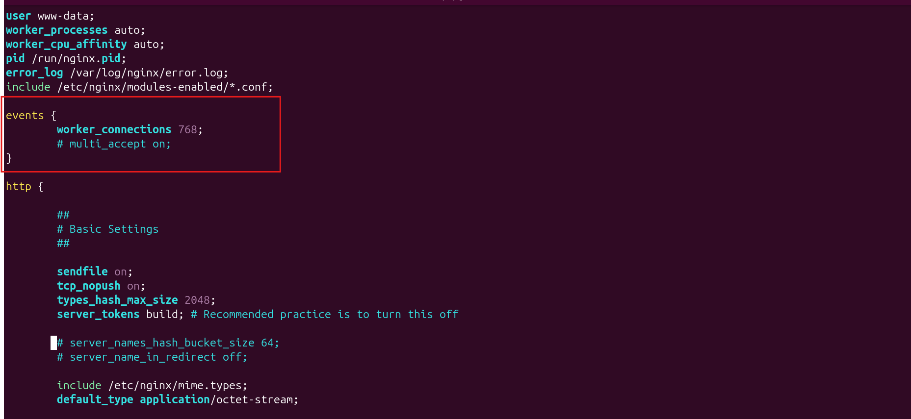

        * **HTTP Context** - *primary container for all configuration directives that deal with web traffix (HTTP/HTTPS)*
          * **mime** - *sets the MIME type for files (used for sending files to clients)*
            * Example:
              * `mime /etc/nginx/mime.types;` - *use the MIME types from the specified file*
              * `mime type/html html;` - *add a new MIME type for files with the `.html` extension*

          * **sendfile** - *enables efficient file transfer*
            * When sending a file to the client, generally the file is read from the disk and added to kernel buffer, then to user buffer (for say here nginx process) and then to the socket buffer and finally send to the client. so there are 3 context switches in this case.
            * With sendfile enabled, the file is read from the disk and sent directly to the socket buffer without involving the user buffer and there are only 2 context switches in this case
            * Example:
              * `sendfile on;` - *enable sendfile (recommended for high-performance servers)*
              * `sendfile off;` - *disable sendfile (default)*

          * **tcp_nopush** - *sets the TCP_CORK socket option to prevent nginx from sending partial packets when sending files (used only when `sendfile` is specified and `tcp_nopush` is not set to `off`)
            * Example:
              * `tcp_nopush on;` - *enable tcp_nopush (recommended for high-performance servers)*
              * `tcp_nopush off;` - *disable tcp_nopush (default)*

          * **types_hash_max_size** - *Sets the maximum memory entry limit for the file-type hashing table*
            * Example:
              * `types_hash_max_size 2048` - *2048 entries (default)*
              * `types_hash_max_size 4096` - *4096 entries (recommended for high-performance servers)*

          * **server_tokens** - *toggles whether to show nginx version details in the HTTP response headers and default error pages
            * Example:
              * `server_tokens on;` - *show nginx version details (default)*
              * `server_tokens off;` - *do not show nginx version details (recommended for security reasons - to prevent attackers from knowing which version of nginx is running)*

          * **tcp_nodelay** - *sets the TCP_NODELAY socket option to prevent nginx from sending partial packets when sending files (used only when `tcp_nopush` is specified and `tcp_nodelay` is not set to `off`)
            * Example:
              * `tcp_nodelay on;` - *enable tcp_nodelay (recommended for high-performance servers)*
              * `tcp_nodelay off;` - *disable tcp_nodelay (default)*

          * **keepalive_timeout** - *sets the keep-alive timeout for connections (used only when `sendfile` is specified and `tcp_nopush` is not set to `off`)
            * Example:
              * `keepalive_timeout 65;` - *keep-alive timeout of 65 seconds (default)*
              * `keepalive_timeout 120;` - *keep-alive timeout of 120 seconds (recommended for high-performance servers)*

            * **listen [IP_ADDRESS]:[PORT] ssl** - *sets the IP address and port on which the server should listen for incoming SSL/TLS connections*
              * Example:
                * `listen [::]:443 ssl;` - *listen on port 443 for IPv6 connections with SSL enabled (recommended for high-performance servers)*
                * `listen 443 ssl;` - *listen on port 443 for IPv4 connections with SSL enabled (default)*

            * **listen [IP_ADDRESS]:[PORT]** - *sets the IP address and port on which the server should listen for incoming HTTP connections*
              * Example:
                * `listen [::]:80;` - *listen on port 80 for IPv6 connections (recommended for high-performance servers)*
                * `listen 80;` - *listen on port 80 for IPv4 connections (default)*

          * **ssl_certificate** - *sets the path to the SSL/TLS certificate file (used only when `ssl` is specified and `ssl_certificate` is not set to `off`)*
            * Example:
              * `ssl_certificate /etc/nginx/ssl/nginx.crt;` - *use the SSL/TLS certificate from the specified file*
              * `ssl_certificate /etc/nginx/ssl/nginx.crt;` - *use the SSL/TLS certificate from the specified file*

          * **ssl_certificate_key** - *sets the path to the SSL/TLS private key file (used only when `ssl` is specified and `ssl_certificate_key` is not set to `off`)*
            * Example:
              * `ssl_certificate_key /etc/nginx/ssl/nginx.key;` - *use the SSL/TLS private key from the specified file*
              * `ssl_certificate_key /etc/nginx/ssl/nginx.key;` - *use the SSL/TLS private key from the specified file*
          * **gzip** - *enables gzip compression to the responses served by the nginx web server*
            * The gzip module compresses files to reduce file size, which can improve performance by reducing bandwidth usage and page load times
            * The browser should support gzip compression. If the browser does not support gzip compression, nginx will not compress the files
            * Example:
              * `gzip on;` - *enable gzip (recommended for high-performance servers)*
              * `gzip off;` - *disable gzip (default)*

          * **gzip_comp_level** - *sets the compression level for gzip compression (used only when `gzip` is specified and `gzip_comp_level` is not set to `off`)*
            * Example:
              * `gzip_comp_level 6;` - *set gzip compression level to 6 (default)*
              * `gzip_comp_level 9;` - *set gzip compression level to 9 (recommended for high-performance servers)*

          * **gzip_vary** - *toggles the insertion of the 'Vary: Accept-Encoding' header into the response (used only when gzip is specified and gzip_vary is not set to off)*
            * Example:
              * `gzip_vary on;` - *enable gzip_vary to tell intermediate proxies and CDNs to cache compressed and uncompressed files separately (recommended for production servers)*
              * `gzip_vary off;` - *disable gzip_vary (default)*

          * **gzip_proxied** - *determines if content should be compressed for requests coming through an intermediate proxy server (used only when gzip is specified)*
            * Example:
              * `gzip_proxied any;` - *compress responses for all proxied requests regardless of headers (recommended when running behind a load balancer or CDN)*
              * `gzip_proxied off;` - *disable compression for all proxied requests (default)*

          * **gzip_buffers** - *allocates the count and size parameters of memory blocks used for compression (used only when gzip is specified)*
            * Example:
              * `gzip_buffers 16 8k;` - *allocate up to sixteen 8-kilobyte chunks of RAM to compress a single response (recommended for high-performance servers)*
              * `gzip_buffers 4 4k; or 4 8k;` - *system default values depending on the specific platform architecture*

          * **gzip_http_version** - *sets the minimum HTTP version standard required for a client to receive compressed data (used only when gzip is specified)*
            * Example:
              * `gzip_http_version 1.1;` - *only compress data for connections running on HTTP 1.1 or newer (default)*
              * `gzip_http_version 1.0;` - *allow compression for older HTTP 1.0 connections*

          * **gzip_types** - *defines the master list of file MIME-types that are allowed to be compressed in addition to text/html (used only when gzip is specified)*
            * Example:
              * `gzip_types text/plain text/css application/json application/javascript text/xml application/xml;` - *compress matching code, text, and data assets over the network (recommended for high-performance servers)*
              * **Default** - *NGINX always compresses text/html automatically, but skips all other file types unless explicitly declared here*

          * **gzip_disable** - *disables gzip compression for specific user agents matching a regular expression (used only when gzip is specified)*
            * Example:
              * `gzip_disable "msie6";` - *disable gzip for ancient Internet Explorer 6 browsers that do not process compressed content properly (recommended for legacy safety)*
              * `gzip_disable "none";` - *do not disable gzip compression for any user agents (default)*
          * **server** - *defines a virtual server block that handles incoming connections (used only when `server` is specified)*
            * Example:
              * `server { ... }` - *define a virtual server block (recommended for high-performance servers)*
              * `server { ... }` - *define a virtual server block (default)*

```bash
# server -> configuration block for a specific virtual server (website or backend/application server)
server {
  listen 80; # -> nginx should listen on the port ( 80 ) to incoming HTTP traffic
  server_name dev.mynext9to5.com # -> which domain name or IP address should(e.g. http://dev.mynext9to5.com)

  # Adjust 50M to whatever max file upload size you want to allow. -> This sets the maximum allowed size for client request bodies (e.g. file uploads).
  client_max_body_size 50M; 

  # Location Directive -> tell nginx how to handle specific URL paths or patterns (e.g. /api, /images, etc.)
  location / {

  # Static File Serving -> serve static files (e.g. HTML, CSS, JavaScript, images)
    root /var/www/dev.yourdomain.com; # -> root directory of the website
    index index.html index.htm; # -> default file to serve if no file is specified in the URL
    # try_files -> try to serve files in the specified order and return the first one that exists
    try_files $uri $uri/ =404; # -> try to serve the requested file, if not found, try to serve the directory, if not found, return 404
    
  # Reverse Proxy Configuration -> tell nginx to forward requests to another server (e.g. Docker container)
    proxy_pass http://localhost:3000; # -> forward requests to the server running on port 3000

  # Essential Headers 
    proxy_set_header Host $host; # -> forward the original host (domain name requested by the user e.g. https://mynext9to5.com) to the server
    proxy_set_header X-Real-IP $remote_addr; # -> forward the original IP address of the client to the server (IMPORTANT for knowing the user's actual IP address)
    proxy_set_header X-Forwarded-For $proxy_add_x_forwarded_for; # -> Appends the user's IP to a list of proxies it has passed through, helps the backend identify the original client IP (important for security/logging)
    proxy_set_header X-Forwarded-Proto $http_x_forwarded_proto; # -> tell the backend if the original request was HTTP or HTTPS (important if NGINX handles SSL termination)
    # -> http_x_forwarded_proto passes along whatever proto header (if any) came from the client (e.g. if client made HTTPS request to nginx, then http_x_forwarded_proto will be https, otherwise it will be http) passes to the backend server
    # -> This way the backend server knows that the original request was HTTPS, even though it is receiving an HTTP request from nginx
    # Note -> if nginx is handling HTTPS SSL termination (decrypting the encrypted HTTPS client traffic before sending it to the backend server), then it will set X-Forwarded-Proto to https or $scheme (Note: $scheme is a variable that holds the scheme of the request, which is https if nginx is handling HTTPS SSL termination, otherwise it will be http)
    
    # WebSocket Support
    proxy_http_version 1.1; # -> Forces NGINX to use HTTP/1.1 which is required for WebSocket connections
    proxy_set_header Upgrade $http_upgrade; # -> Passes the Upgrade header so NGINX knows to transition the connection from HTTP to WebSocket
    proxy_set_header Connection $connection_upgrade; # -> Passes the usually "Connection: upgrade" header to tell the backend to maintain the connection for the WebSocket session
    proxy_buffering off; # -> Disables NGINX's buffer writing for the connection. This is often recommended for WebSocket connections to ensure low-latency, real-time data transfer without NGINX holding chunks of data before sending
    proxy_read_timeout 86400s; # -> Sets the maximum time to wait for a response from the backend to 24 hours (recommended for WebSocket connections, preventing Nginx from closing the idle WebSocker connection used by HMR)
    # WebSocket Keep-Alive
    proxy_set_header Sec-WebSocket-Version 13; # -> Forces NGINX to tell the Backend that client (e.g. Browser) is using WebSocket version 13, which is the standard version
    proxy_set_header Sec-WebSocket-Key $http_sec_websocket_key; # -> NGINX Forwards the unique, randomly generated cryptographic key send by the browser to the backend, which needs this ke to prove to the browser that it received the request and supports the WebSockets
    proxy_send_timeout 86400s; # -> Keeps the sending channel open for 24 hours as well
    
  }
}
```

### SSL

*Secure Sockets Layer (SSL) is a security protocol that creates an encrypted connection between a client (e.g. browser) and a server (e.g. NGINX).*

> Enhanced version of TCP

**The main purpose of SSL is to:**
1. **Encryption**: Ensures data confidentiality and integrity during transit by scrambling data so only authorized parties can understand it.
2. **Authentication**: Verifies the identity of the server (and optionally the client) to prevent impersonation and ensure secure communication.
3. **Trust**: Builds user confidence by displaying the padlock icon and “https://” in the browser, indicating a secure connection.

**How does SSL work ?**

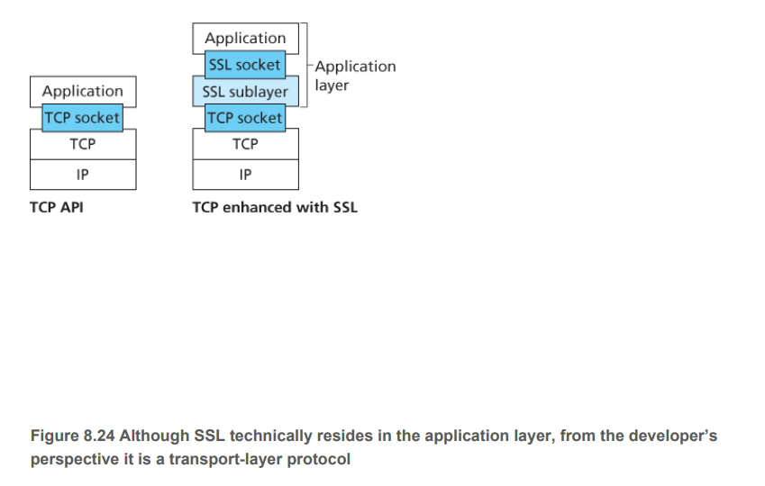

>Note: client and server are communicating via SSL, not directly.
* **SSL Phases:** SSL works in three phases,
  * handshake ->
    * client establishes a TCP connection with server (3-way handshake)
    * Verify server is the real server (by using digital certificate) and a trusted Certificate Authority (CA).
    * client and server exchange the security capabilities (SSL version, cipher suites (RSA, DH, ECDHE etc) compression methods).
    * client generates a random Pre-Master Secret, encrypts it with the server public key, and send it to the server
    * server decrypts the Pre-Master Secret with its private key
    * both sides independently compute the final Symmetric Session Key (the master secret is never transmitted back and forth).
  * key exchange and cipher change phase ->
    * switching the connection from asymmetric to symmetric encryption
    * both parties send a ChangeCipherSpec message to signal that they are ready
    * they exchange encrypted Finished message to verify that the keys match and the handshake was successful
  * data encryption phase (secure transfer) ->
    * safe transmission of data
    * actual application data (like HTTP traffic) is symmetric key encrypted using the generated session key.
    * data integrity is continuous verified using a Message authentication code (MAC) that is present in encrypted data, to prevent tampering. So if an attacker modifies the data in transit, the MAC will not match, and the connection will be terminated.

*SSL uses public-key cryptography (asymmetric encryption) only during the handshake phase to exchange the symmetric session key, and uses symmetric-key cryptography to encrypt the actual application data during the data encryption phase.*

*SSL is the predecessor to TLS (Transport Layer Security), and while the terms are often used interchangeably, TLS is the newer, more secure version.*

**How NGINX uses SSL**

*NGINX acts as a reverse proxy and handles SSL termination, meaning it decrypts the encrypted HTTPS client traffic before forwarding it to the backend server as plain HTTP.*

#### NGINX SSL Configuration

**Get the SSL certificate**

**Certbot** -> free, open-source software tool built by Electronic Frontier Foundation (EFF) that automates the process of obtaining, installing, and renewing SSL/TLS certificate.

* acting a client for [Let's Encrypt](https://letsencrypt.org/) -> non-profit certificate authority (CA) that provides free SSL/TLS certificates to the public.
* Certbot can be installed on Linux, Windows, and macOS.

**Types of Certificates**
  * Domain Validated (DV) Certificate -> only verifies domain ownership
  * Organization Validated (OV) Certificate -> verifies domain ownership and organization details
  * Extended Validation (EV) Certificate -> verifies domain ownership and organization details (most secure)

**SSL/TLS Certificate files**
  * Certificate file -> .crt
  * Private key file -> .key
  * Certificate Chain file -> .ca-bundle or .crt (contains intermediate certificates)

**Challenge**
  * To prove you own 'yourdomain.com', [Let's Encrypt](https://letsencrypt.org/) gives Certbot a 'challenge'.
  * if using nginx plugin, certbot will create a temporary secret file inside your web directory.
  * Certbot tells the server where to put this file using HTTP redirect. If the web server is running and configured correctly, it will serve that file at the specified location.
  * Certbot reads the content of the file and sends it to Let's Encrypt, which verifies it. If everything is correct, Let's Encrypt will issue the SSL certificate.

**Certificate Installation**

```bash 
sudo apt update
sudo apt install certbot python3-certbot-nginx
```

**After installation to get the software**

```bash
sudo certbot --nginx -d example.com -d www.example.com # -> --nginx flag tells Certbot to use the NGINX plugin to automatically configure NGINX to use the SSL certificate, -d flag specifies the domain name for which the SSL certificate is to be obtained
```

* Once the certificate is obtained, NGINX needs to be configured to use it.
* This involves telling NGINX where the certificate and private key files are located and configuring the server block to listen on port 443 (HTTPS).

**Configure NGINX to use SSL**

```bash
server {

  # ssl configuration
  ssl_certificate /etc/ssl/certs/{yourdomain.com.crt};
  ssl_certificate_key /etc/ssl/private/{yourdomain.com.key};

  # Supported TLS Protocols (Disable old, insecure SSL/TLS version)
  ssl_protocols TLSv1.2 TLSv1.3; # -> TLS 1.2 and TLS 1.3 are secure and widely supported versions of TLS

  # Preferred Cipher Suites for strong security
  ssl_prefer_server_ciphers on; # -> Ensures NGINX prioritizes the server's preferred cipher suites over the client's
  ssl_ciphers HIGH:!aNULL:!MD5; # -> Disables NULL encryption and MD5 cipher, both of which are insecure

  # HSTS (HTTP Strict Transport Security)
  # HTTP Strict Transport Security (HSTS) is a security policy that forces browsers to connect only via the HTTPS protocol
  add_header Strict-Transport-Security "max-age=6307200; includeSubDomains; preload" always; # -> Force browser to always use Strict Transport Security (connect via only HTTPS) for the next year, including for all sub-domains

  # Session Configuration
  ssl_session_cache shared:SSL:10m; # -> Specifies a shared memory cache named SSL with a size of 10 megabytes, where NGINX can store SSL session information for faster reconnection
  ssl_session_timeout 10m; # -> Sets the timeout for SSL sessions to 10 minutes, after which sessions will be removed from the cache
}
```
