# Vector Databases & ChromaDB Guide

Comprehensive reference on vector embeddings, multi-dimensional similarity metrics, database topologies, and hands-on ChromaDB operations with Python and Sentence Transformers.

---

## Table of Contents

- [Core Concepts & Motivation](#vector-database-concepts)
  - [Why Vector Databases?](#uses-of-vector-databases)
  - [What is a Vector?](#vector)
  - [Vector Databases and Transformer Models](#vector-databases-and-transformer-models)
- [Vector Database Classifications](#vector-database-types)
  - [In-Memory Vector Databases (Milvus, RedisVL)](#in-memory-vector-databases)
  - [Disk-Based Vector Databases (Annoy, ScaNN)](#disk-based-vector-databases)
  - [Distributed Vector Databases (FAISS, Elasticsearch)](#distributed-vector-databases)
  - [Graph-Based Vector Databases (Neo4j, Amazon Neptune)](#graph-based-vector-databases)
  - [Time-Series Vector Databases](#time-series-vector-databases)
- [Dedicated Vector DBs vs. Traditional Relational Extensions](#dedicated-vector-databases-vs-databases-supporting-vector-search)
  - [Relational Databases with Vector Extensions (pgvector)](#relational-databases-with-vector-extensions)
  - [Dedicated Vector Search Engines (Pinecone, Weaviate)](#vector-search-engines)
  - [Real-World Applications](#application-of-vector-databases)
- [Similarity Search & Distance Metrics](#similarity-search)
- [ChromaDB Deep Dive](#chromadb)
  - [Core Capabilities](#chromadb)
  - [Deployment Architectures (Client-Server vs. In-Process)](#deployment)
  - [Workflow & Architecture](#architecture)
  - [Client Libraries](#clients)
- [ChromaDB Hands-On Code Examples](#chromadb-code-examples)
  - [Query Syntax (`get`, `query`, `delete`)](#query-syntax)
  - [Collection Creation with Hugging Face Embeddings](#creating-collections)
  - [Adding Documents with Metadata](#add-documents-to-collection)
  - [Filtering by Metadata (`$eq`, `$and`, `$in`, `$lt`)](#filter-using-metadata)
  - [Filtering by Document Content (`$contain`, `$or`)](#filter-using-document-content)

---

*What you get out of this course ?*

* Improve data retrieval skills
* expertise in similarity search and vector dbs
* vector vs traditional dbs
* importance of vector dbs in recommendation system and RAG

1. work with chromadb
2. real world app with chromadb and embedding model from hugging face
   1. database management
   2. similarity search techniques
   3. advance vector operations

## Vector Database Concepts

*Companies use vector databases to:*
   * find information
   * mine data
   * support machine learning

> Vector databases simplify organization, storage and retrieval of data in a multi-dimensional space (vectors) based on their semantic meaning (proximity - i.e. how close they are in mathematical space aligns with the meanings of the vector dimensions)
>
> Vector databases help in retrieval by making the operations of 
> * grouping items
> * finding nearest neighbors
> * classifying items
> * clustering similar items
> * efficiently searching large datasets semantically
 
### Uses of Vector Databases

* Handles non-tranditional data and complex datatypes
  * relationship data (i.e. social likes, geospatial data, genomic data)
  * Text
  * Images
  * Audio
  * Video
  * structured data
  * unstructured data
* Vector dbs enable:
  * Easy storage
  * Fast Retrieval
  * Scalability
* Vector dbs help in similarity search using concepts of proximity
  * cosine similarity
  * euclidean distance
  * Hamming similarity
  * Jaccard similarity
  * dot product similarity
* Vector dbs can use:
  * Distributed computing
  * indexing
  * parallel processing
    * *To manage* -> big datasets, large scale similarity search
* Can help in,
  * biology -> drug discovery, protein folding, climate data analysis
  * healthcare -> calculating patient outcomes
  * e-commerce -> delivering product recommendations
  * social media -> sharing social connection sugggestions
  * traffic planning -> traffic analysis
* Vector databases help to build AI driven apps - like ChatGPT, AI search engine and recommendation systems
* Store and retrieve machine learning data
  * integrate easily into the pipelines
  * speed the creation of ai powered apps
* Enhances search capabilities
  * semantic search (content matching, not just keyword)
  * image search
  * voice/audio search

### Vector

*stores data as mathematical objects defined by their size and direction*

*mathematical object defined by size and direction (i.e. length and direction in space)*

*can represent many types of data*
  * Images
  * Sounds
  * Text files
  * Pattern data
  * Mapping data
  * Genomic data
  * ... and more
*an array of numerical values that relate to different features of the data*

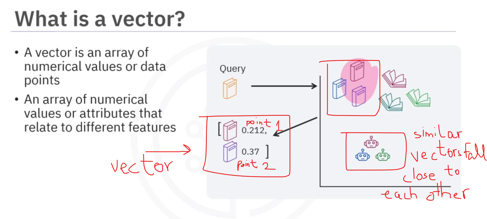

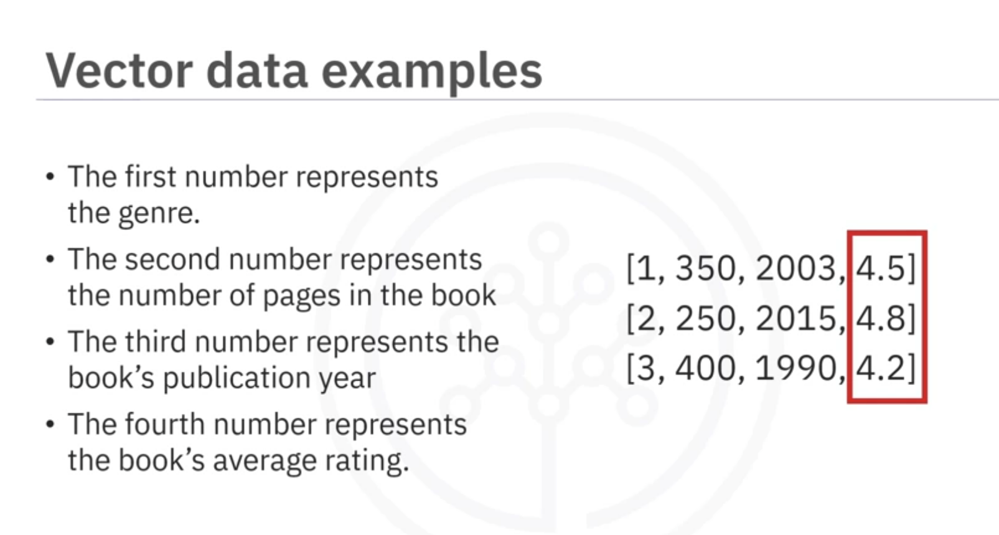

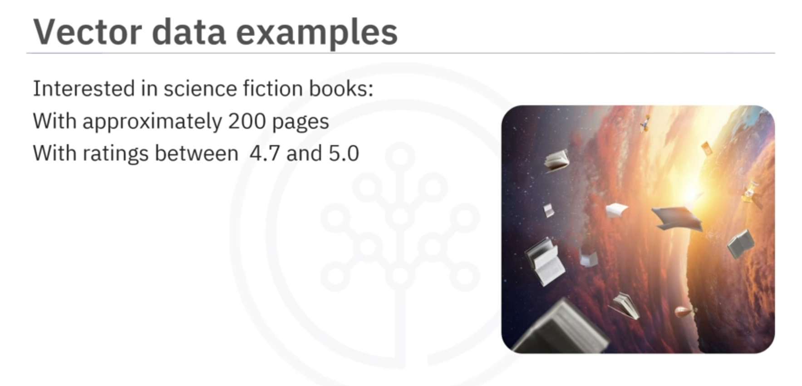

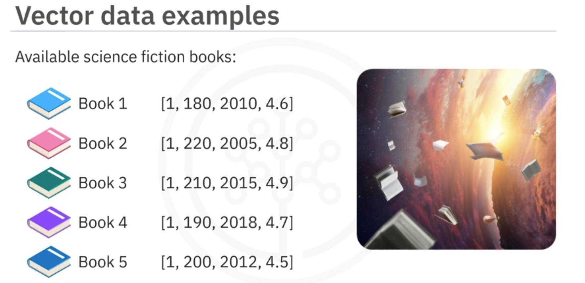

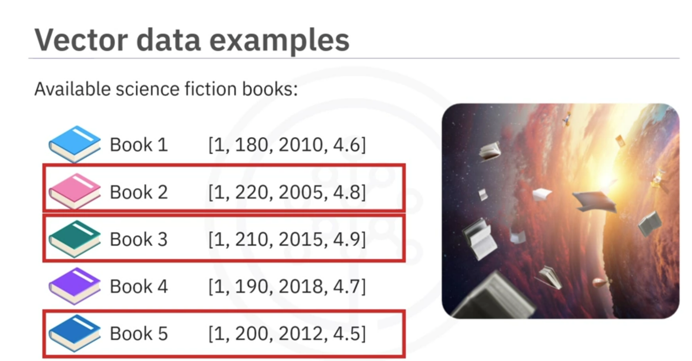

#### Vector Databases and Transformer Models

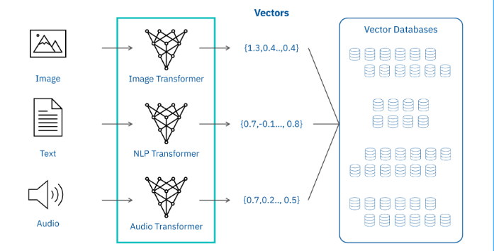

### Vector Database Types

*categorize popular vector databases based on their types, capabilities, and vendors.*
*contrast the functions and characteristics of dedicated vector databases and traditional databases that have added vector search capabilities.*
*identify popular vendors of dedicated vector databases and databases that support vector search.*

#### In-memory vector databases

* DBs that store vectors directly in the memory (volatile ~ RAM)
* Enable rapid access to data, making read and write operations swift
* Support realtime analytics and recommendation systems
* Use cases include real time fraud detection, real time personalized recommendations, AI chatbots
* Examples include
  * Milvus -> Enterprise grade, open source, built for massive scale. It is used for Approximate nearest neighbor (ANN) search and similarity search. Handles huge datasets and high dimension vectors by loading data in segments. Supports real time search on billions of vectors
  * RedisVL -> Redis Vector Library. Provides vector storage and similarity search capabilities to Redis database.

#### Disk-based vector databases

* store vectors on a disk
* suits when data doesn't fit in memory (e.g. in TBs)
* uses compressed indexed and memory mapping techniques for pulling the required data into the memory during a search
* Advantage: cost-effective for large-scale storage.
* Disadvantage: slower retrieval compared to in-memory databases.
* Use cases: large-scale analytics and batch processing.
* Examples:
  * Annoy -> Approximate Nearest Neighbors Oh Yeah is built by Spotify for recommendation of songs and is open source. indexes are built only, and you can't insert new vector into an existing annoy index. Best for memory constrained environments and applications that require fast search on a large dataset. Built for speed and scalability, using random projection trees.
  * ScaNN -> Scalable Nearest Neighbors is an open source library for efficient vector similarity search and clustering, developed by Google. Best for large scale vector search and clustering applications.

#### Distributed vector databases

* Spread vector data across multiple nodes of servers
* Horizontal scaling and fault tolerance
* Suitable for managing massive data serts and high-throughput tasks
* Examples:
  * FAISS -> Facebook AI Similarity Search
  * Elasticsearch with Vector Plugin
  * Dasj-ML

#### Graph-based vector databases

* model data as a graph
* nodes and edges represent vector attributes or embedding
* excel at capturing complex relationships
* facilitate graph analytics
  * Example:
    * Neo4j
    * Amazon Neptune
    * TigerGraph

#### Time-series vector databases

* data collected over time intervals
* represent this data as vectors
* these vector dbs are robust tools for time series analysis and forecasting, anomaly detection in time series data, and time series retrieval.
* Examples:
  * InfluxDB
  * TimescaleDB
  * Prometheus

### Dedicated vector databases vs Databases supporting vector search

* Systems for handling vectors can be broadly categorized into two groups:
1. Vector Search Engine (VSE): Also known as Vector Database.
   1. similarity search, clustering and classification work better in vector dbs
   2. use unique data structures optimized for vector data
      1. reversed index
      2. product quantization
      3. Locality-sensitive hashing (LSH)
   3. use advanced indexing like HNSW, IVF-PQ for fast and accurate search
   4. scales well for high dimensional data
2. Example: 
   1. FAISS
   2. Annoy
   3. Milvus
3. Vector Support in Traditional Databases
   Either
      * Traditional database extensions (e.g. PostgreSQL with pgvector extension, MongoDB with Atlas Vector Search)
        * Adding Vector support to existing databases (e.g. PostgreSQL with pgvector extension, MySQL with MySQL Vector Search extension)
        * Using specialized vector search engines (e.g. Pinecone, Weaviate)
      * Are data processing frameworks or libraries
      * these contain tools and add ons for vector searches and other types of quiries
        * you can store vector data as a part of the data model (Blobs, Arrays, User-defined types)
        * Indexing: You can organize your data using standard or custom indexes
        * Integration: Add-ons and integrations, such as libraries and plug-ins

#### Relational databases with vector extensions

* Popular relational databases that have added vector search capabilities
* They support both structured and unstructured data
* Examples:
  * PostgreSQL with pgvector extension
  * MySQL with MySQL Vector Search extension

#### Vector Search Engines

* Specialized search engines optimized for vector search
* They provide advanced search capabilities and features
* Examples:
  * Pinecone -> managed vector database and search engine, built for speed, scalability, and ease of use.
  * Weaviate -> open source vector search engine, designed for AI applications, provides vector storage, search, and management capabilities.

#### Application of vector databases

* analyze images and videos
* recommendation systems
* geospatial analysis and location-based services
* 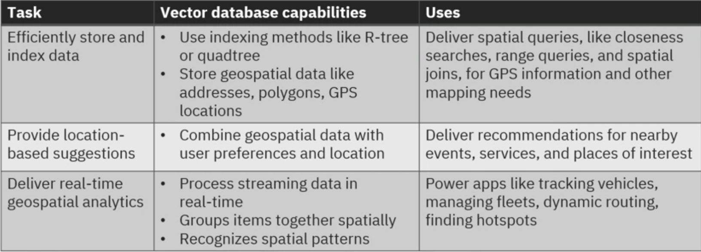
* deliver social and marketing insights
* 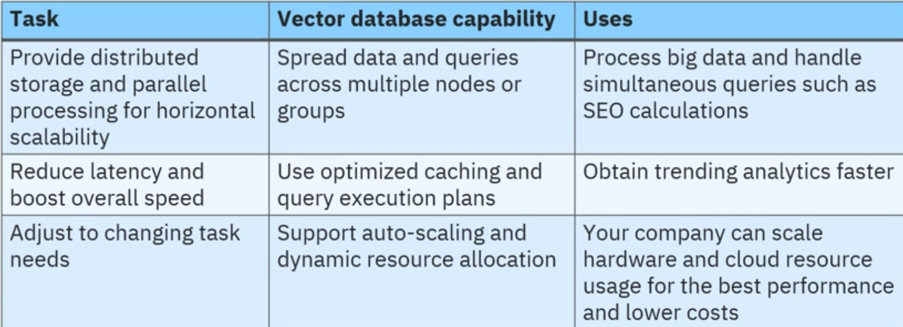

> **Perform future extraction and representation**
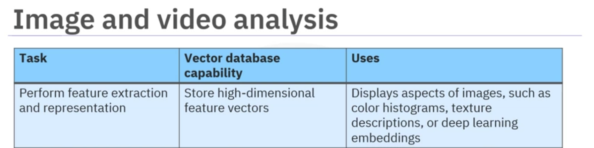
> store high dimensional feature vectors to store qualitative representations, and then view the aspects of images (i.e. color histograms, texture descriptions, deep-learning embeddings, and object recognition)
>
> **Similarity Searches**

> use the ability to store feature vectors, and then use the ability to locate images, and suggest images and videos based on similar features in other data present
>
> **Process real-time data**
> 
> provide horizontal scalability for real-time data storage (perform video surveillance, object recognition, and live event analysis ?)
>
> Example:
> * AI gallery/google drive -> stores the vector representations of the images and then any new image added is converted to it's vector representation. this will then be feature matched to the closest cluster of images and stored there.
>   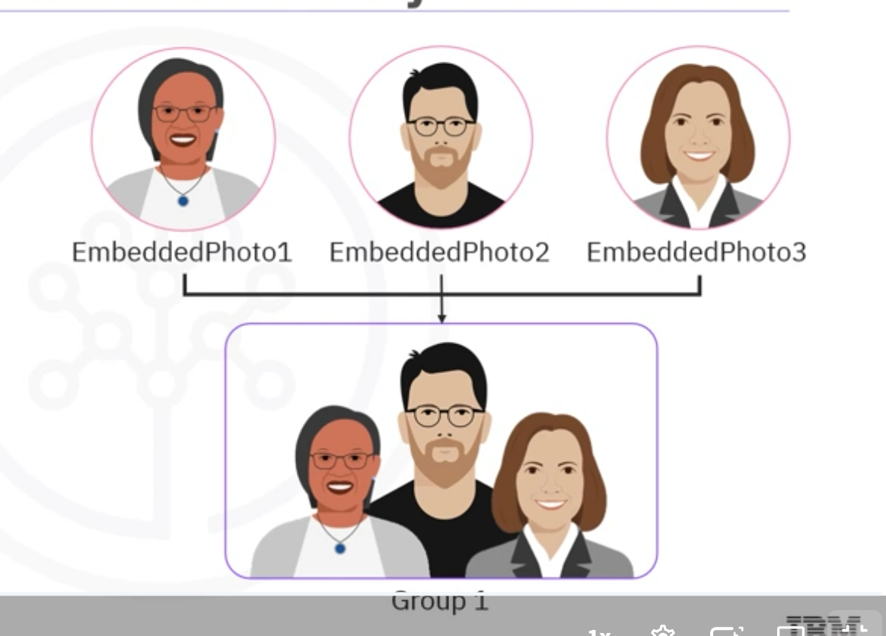
> **System Recommendation**
> 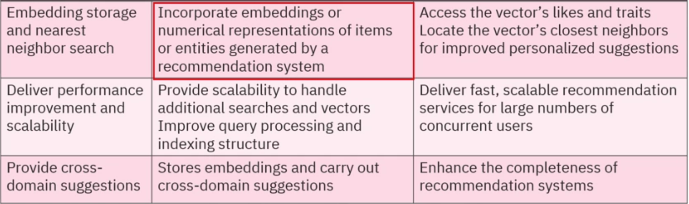

### Similarity Search

*finding items that are most similar to the given query.*
> Note:
> * at the core of similarity search is the distance metric or similarity metric (choice of metric changes the result) that quantifies how similar two items are.
> 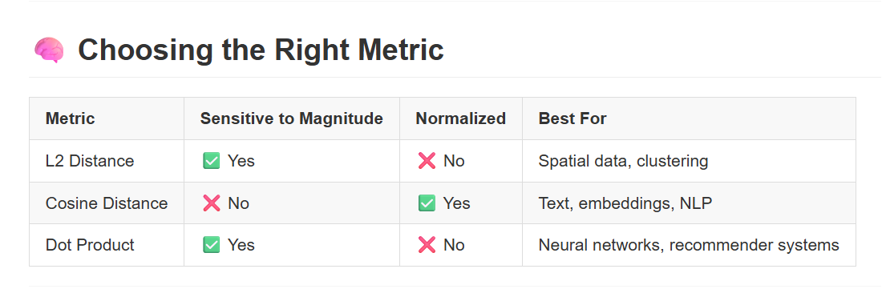
> 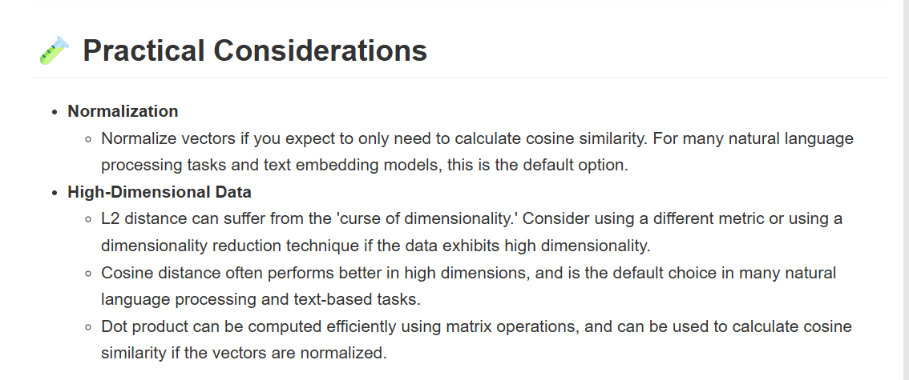

### ChromaDB

**Chroma is an open-source, vector database, to support ai-operations**

* core features and capabilities of chroma db
* different deployment options of chroma db
* architecture and workflow of chroma db
* data operations on chroma db

**Capabilities**
* storage of embeddings and their metadata (vector representations and their metadata of chunks)
* vector search to find text on similarity and identifying similar vectors using semantics
* full text search, based on lexical or text matching
* document storage for raw document and their embeddings
* metadata filtering to improve the accuracy of retrieval process to narrow down targets
* multi-modal retrieval to help out storing and retrieving images, videos and texts

**Deployment**

* client-server architecture
  * chroma client connects to a server running as another process
  * server can be launched by CLI or in a docker image
  * client connects to the server using http protocol (locally and remote)

* python
  * chroma can run alone in a stand alone mode
  * server and client are running in a single process
  * useful for quick testing or if the server is expected to run on the single machine (client and server)

**Architecture**

*works in multiple phases*

1. (Optional) get embeddings of texts, images, and videos using an embedding model
2. create collections - chroma db stores all its data in collections (like a database. i.e. Create Database xyz)
3. storing data - store embeddings and their metadata in collections.
4. perform collection operations - deleting, updating and renaming collections
5. query in group data based on semantic similarity

**Clients**

* Official Clients:
  * Python
  * Javascript
* Community Supported:
  * Java, C#, Go, Ruby, Rust, PHP
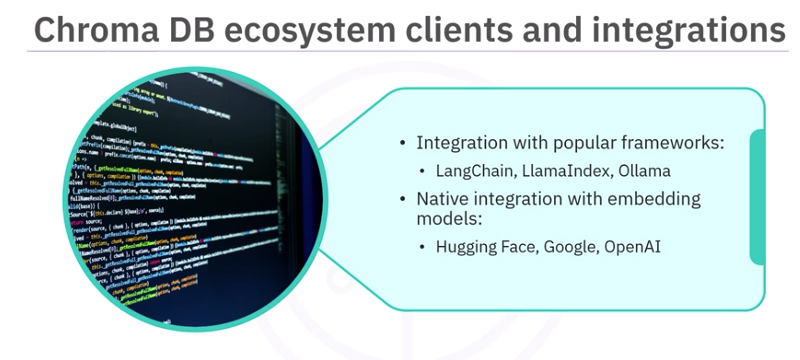


**Performance**

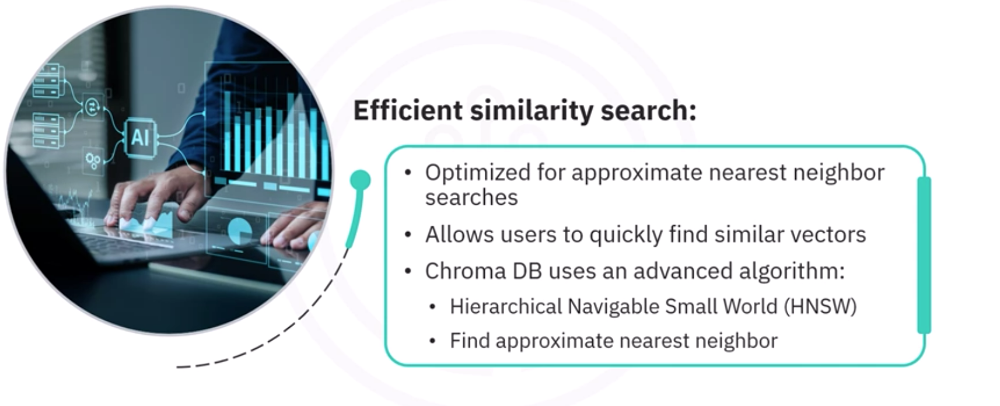
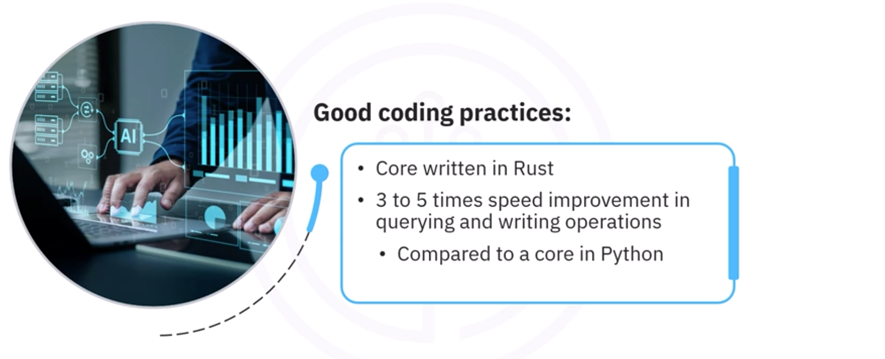

#### ChromaDB code examples

**query syntax**

```python
collection.get()      # -> retrieve records directly by their ID or by applying metadata filter. returns exact match and doesn't perform similarity search
```

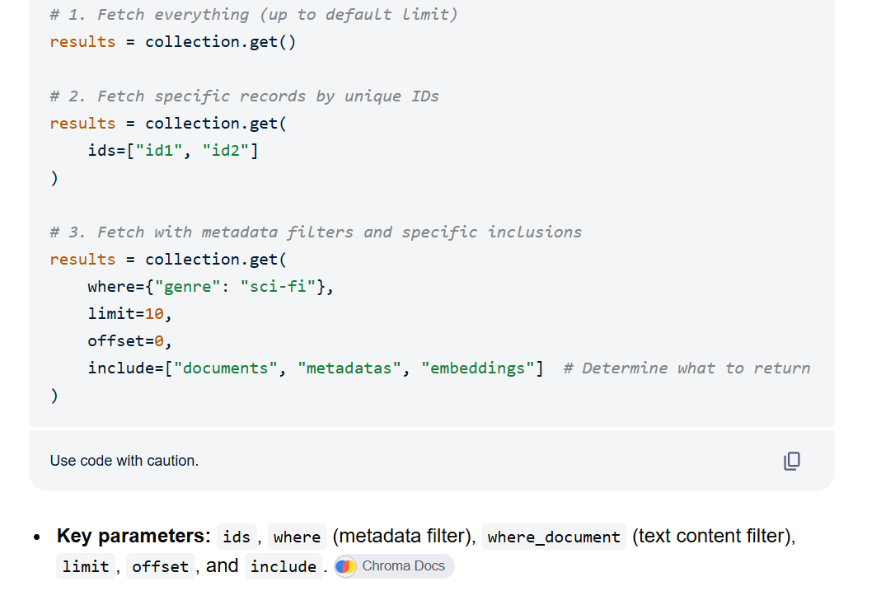

```python
collection.query()    # -> semantic vector search, takes query or query vector embeddings, computes distance and returns nearest neighbors
```

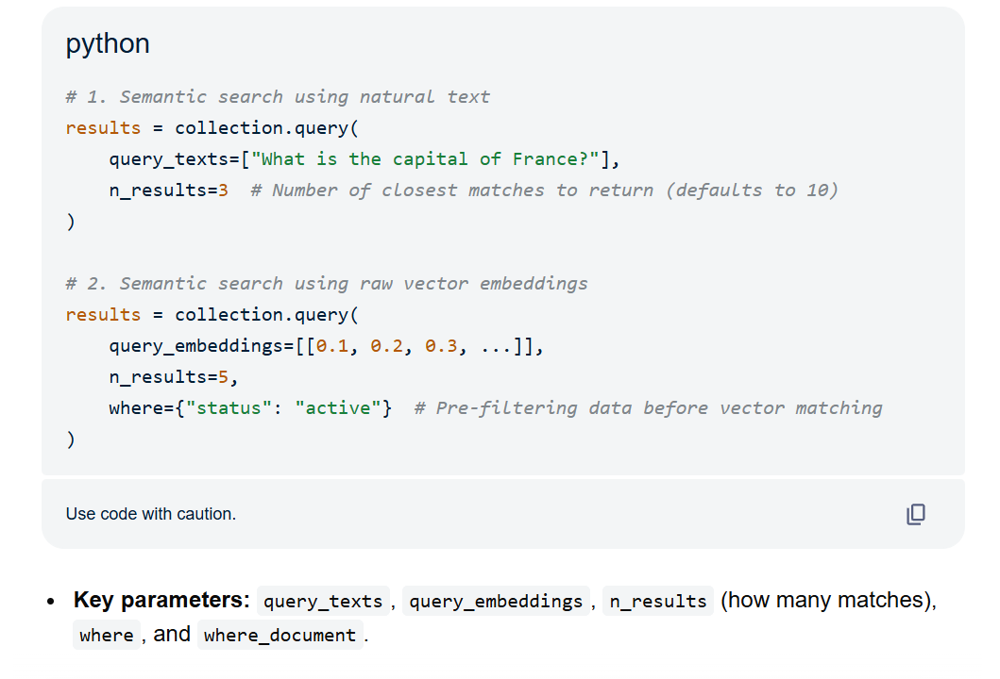

```python
collection.delete() # -> permanently remove records from collection using target criteria. deletes embeddings, documents, and metadata.
```
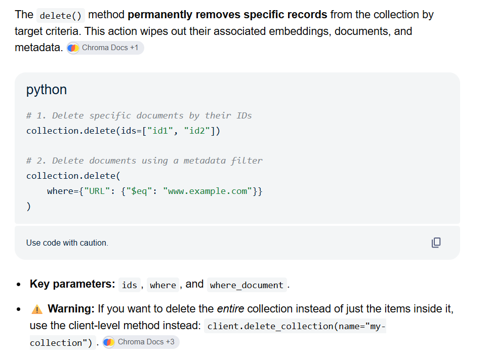

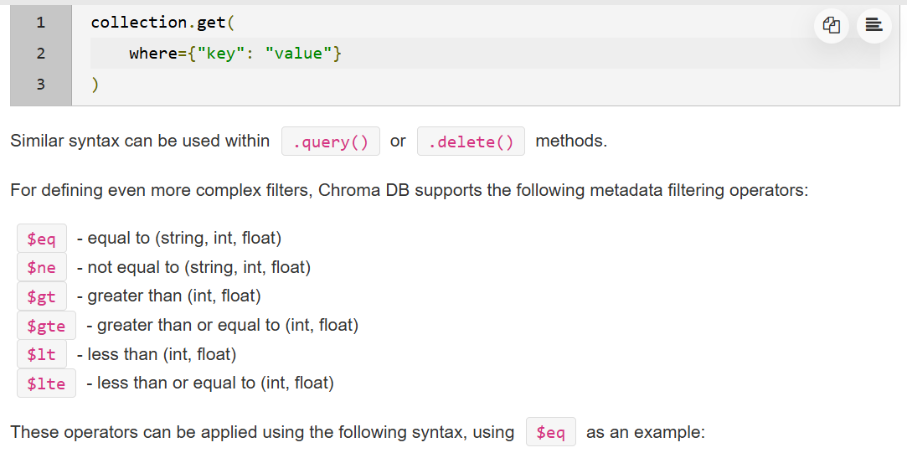
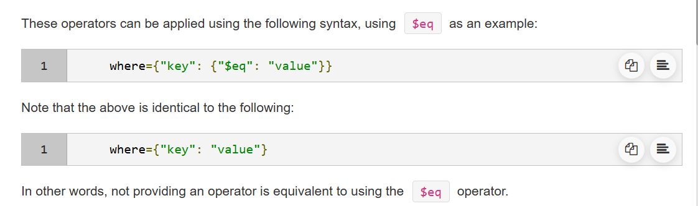
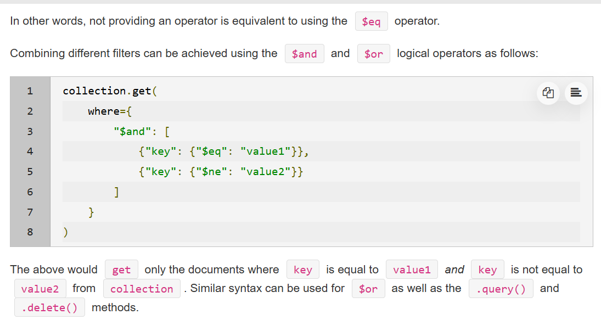
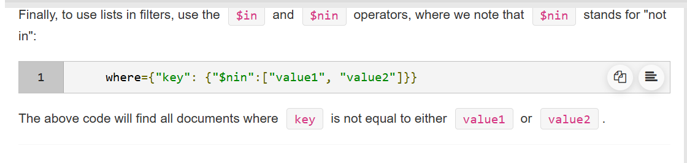
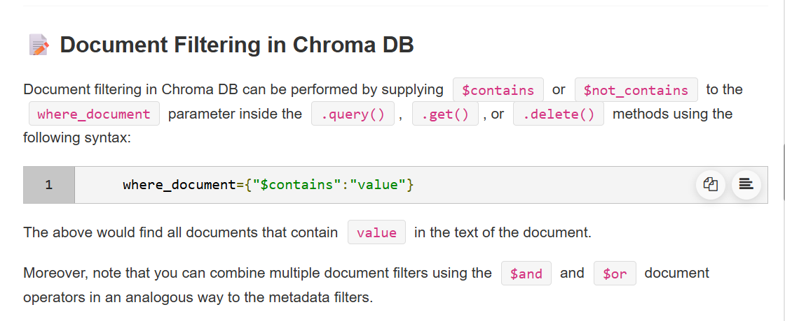

```python
import chromadb
from chromadb.utils import embedding_functions

ef = embedding_functions.SentenceTransformerEmbeddingFunction(
  model_name="all-MiniLM-L6-v2"
)


###############
## Creating Collections
###############

client = chromadb.Client()
collection = client.create_collection(
  name = "filter_demo",
  metadata = {
    "description": "Used to demo filtering in ChromaDB"
  },
  configuration = {
    "embedding_function": ef
  }
)
print(f"Collection created: {collection.name}")

###############
## Add Documents to collection
###############

collection.add(
  documents = [
    "This is a document about LangChain",
    "This is a reading about LlamaIndex",
    "This is a book about Python",
    "This is a document about pandas",
    "This is another document about LangChain"
  ],
  metadatas = [
    {"source": "langchain.com", "version": 0.1},
    {"source": "llamaindex.com", "version": 0.1},
    {"source": "python.com", "version": 0.1},
    {"source": "pandas.com", "version": 0.1},
    {"source": "langchain.com", "version": 0.1},
  ],
  ids = ["id1", "id2", "id3", "id4", "id5"]
)

###############
## Filter using metadata
###############

collection.get(
  where={
    "source": {
      "$eq": "langchain.com"
    }
  }
)
```

**output**
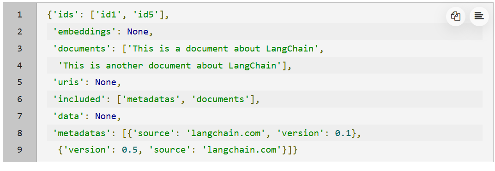

```python
collection.get(
  where = {
    "$and": [
      {"source": { "$eq": "langchain.com" }},
      {"version": { "$lt": 0.3 }}
    ]
  }
)
```

**output**
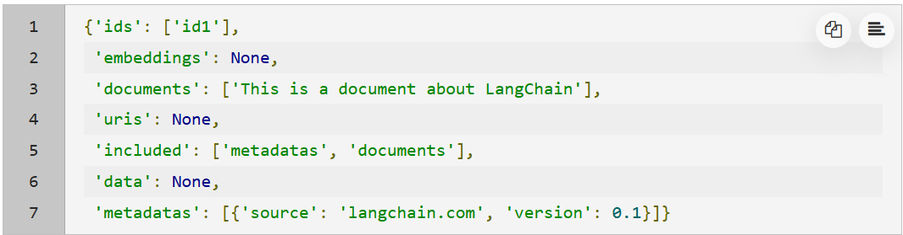

```python
collection.get(
  where = {
    "$and": [
      {"source": {"$in": ["langchain.com", "llamaindex.ai"]}},
      {"version": {"$lt": 0.3}}
    ]
  }
)
```

**output**
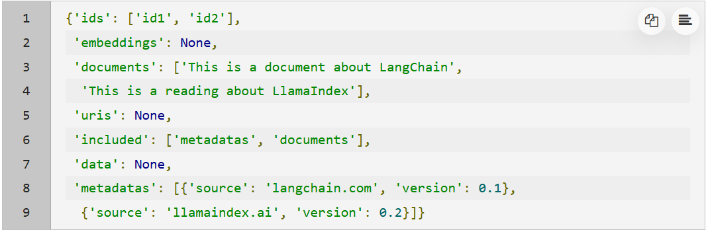

```python
###############
## Filter using document content
###############

collection.get(
  where_documents = {
    "$contain": "pandas"
  }
)
```

**output**
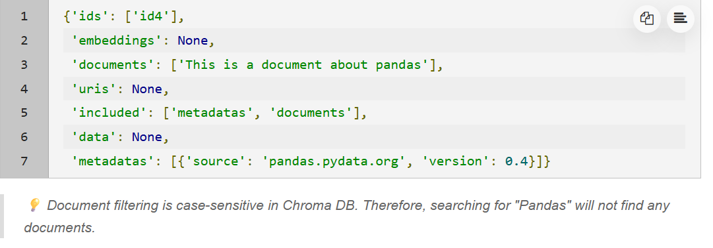

```python
###############
## Combining document and metadata filtering
###############

collection.get(
  where = {"version": {"$gt": 0.1}},
  where_document = {
    "$or": [
      {"$contains": "Langchain"},
      {"$contains": "Python"}
    ]
  }
)
```

**output**
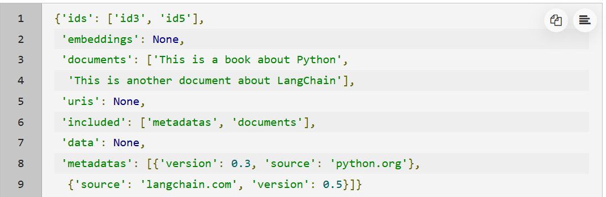


#### Essential database operations in chroma db

* create collections in chroma db
* modify collections in chroma db
* add, update and delete documents in chroma db

**collections are a way to organize data**
