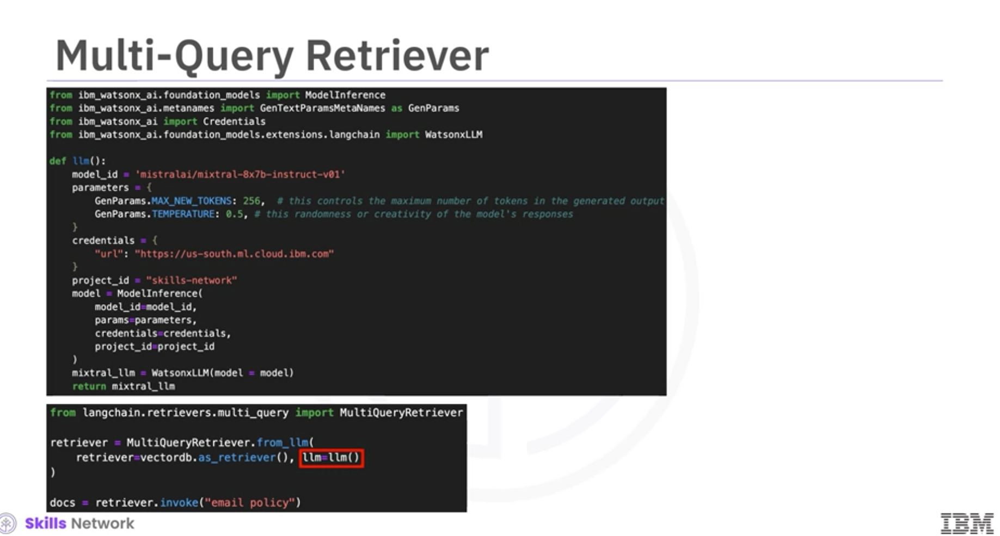
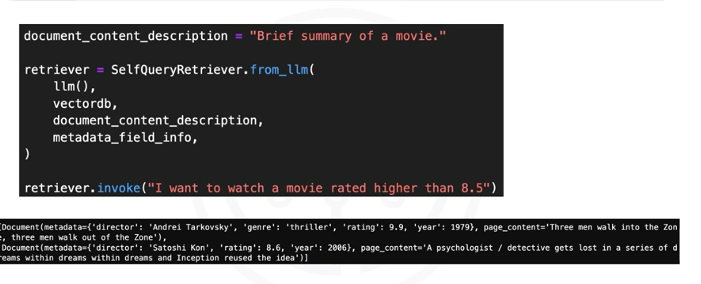
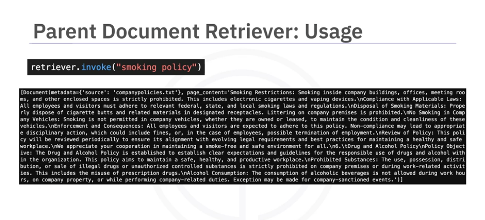
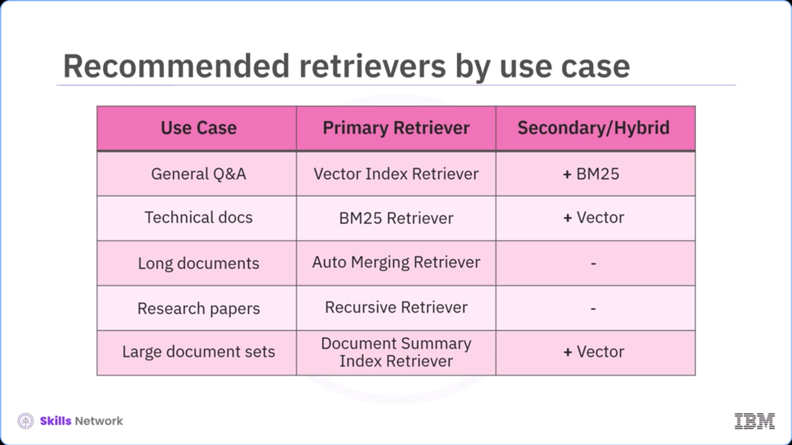

# Advanced Retrievers in LangChain & LlamaIndex

In-depth guide to modern retrieval strategies in LLM applications, comparing vector-store search, multi-query generation, self-querying with structured metadata filters, parent document chunking, and rank fusion algorithms.

---

## Table of Contents

- [LangChain Retrievers Overview](#what-a-langchain-retriever-is)
  - [Vector-Store Retrieval & Maximal Marginal Relevance (MMR)](#vector-store-based-retrieval)
- [Specialized LangChain Retrievers](#describe-different-langchain-retriever)
  - [Multi-Query Retriever](#multi-query-retriever)
  - [Self-Query Retriever (Metadata Filtering)](#self-query-retriever)
  - [Parent Document Retriever (Hierarchical Splitting)](#parent-document-retriever)
- [Advanced Retrievers in LlamaIndex](#advanced-retrievers-in-llama-index)
  - [Index Types (Vector Store, Document Summary, Keyword Table)](#core-index-types-in-llama-index)
  - [Lexical & Keyword Retrieval (TF-IDF vs. BM25)](#retrievers)
  - [Auto-Merging Retriever & Recursive Retrieval](#auto-merging-retriever)
  - [Query-Fusion Retrievers](#query-fusion-retriever)
- [Fusion Ranking Strategies](#fusion-strategies-supported-by-the-query-fusion-retriever)
  - [Reciprocal Rank Fusion (RRF)](#reciprocal-rank-fusion)
  - [Relative Score Fusion](#relative-score-fusion)
  - [Distribution-Based Fusion](#distribution-based-fusion)

---

## part 1

**What langchain retrievers are ?**
**Describe vector-store based retrievers and how they work ?**

**What a langchain retriever is?**
* An interface that returns documents based on an unstructured query
* More general than a vector store
* doesn't necessarily store document, but has main purpose of retrieving documents/chunks
* accept a string query as input and output a list of document or chunks as output

*several implementations possible*

**Simplest Type of Retrieval**

**Vector-Store based retrieval**
* load documents from vector store (database)
* brought the store by
  * loading the main document
  * splitting into chunks
  * embedding them
  * storing them
* Simply plug the vector store retriever
  * embed the query (question)
  * similarity search the question with the with MMR(max-marginal relevance)
  * doesn't require an llm to retrieve the chunk

**MMR**
* balance the relevance and diversity of the retrieved chunks (chunks should be relevant to the query and minimally similar to previous selected documents)
* avoid redundancy and cover different aspects of the query

```python
retriever = vectordb.as_retriever(search_type="mmr")
docs = retriever.invoke("email policy")
```

## part 2

**Describe different langchain retriever**
* **Multi-query retriever**
* **self query retriever**
* **parent document retriever**
**Identify the difference between these retriever**

**Multi-query retriever**

* Similar to the vector-based query
* **Difference**
  * Create different versions of the query
  * retrieve documents for all versions of query
  * overcome the differences in results due to poor wording or poor embeddings
  * the semantics of the query is well understood


**self-query retriever**

* converts the query into two components
  * a string to look up to semantically
  * metadata filter to go along with it

**Setup**

```python
vectordb = Chroma.from_documents(docs, whatsonx_embedding) # embed the documents and store them in the vector db

metadata_field_info = [
    AttributeInfo(
        name="genre",
        description="The genre of the movie. One of ['science', 'comedy', 'drama', 'thriller']",
        type="string"
    ),
    AttributeInfo(
        name="year",
        description="The year the movie was released in.",
        type="integer"
    ),
    AttributeInfo(
        name="director",
        description="The name of the movie director",
        type="string"
    ),
    AttributeInfo(
        name="rating",
        description="A 1-10 rating of the movie",
        type="float"
    )
] # help the llm choose relevant documents from the retrieved chunks sent to the llm

document_content_description = "Brief summary of a movie."

retriever = SelfQueryRetriever.from_llm(
    llm(),  # llm to send the queried documents to
    vectordb,   # vector store 
    document_content_description,   # document descriptions
    metadata_field_info,    # metadata field description
)

retriever.invoke("I want to watch a movie rated higher than 8.5")
```


**Parent Document retriever**

*splitting documents have often conflicting requirements*
  * you want small documents so their embeddings can accurately reflect their meanings
  * you want long enough documents, so the context of each chunk is retained

* During retrival
  * fetch the small chunks
  * look up their parent id
  * fetch the large document in which the small chunk lives

```python

# two splitters
    # parent splitter -> chunks the document in longer documents to be retrieved
    # child splitter -> chunks the documents in small chunks for meaningful embeddings
# two store 
    # vector store for the embeddings
    # store for the documents

from langchain.retrievers import ParentDocumentRetriever
from langchain_text_splitters import CharacterTextSplitter
from langchain.storage import InMemoryStore

parent_splitter = CharacterTextSplitter(chunk_size=2000, chunk_overlap=20, separator='\n')
child_splitter = CharacterTextSplitter(chunk_size=400, chunk_overlap=20, separator="\n")

vectordb = Chroma(
    collection_name="aplit_parents", embedding_function=watsonx_embedding
)

# The storage layer for the parent documents
store = InMemoryStore()

retriever = ParentDocumentRetriever(
    vectorstore=vectordb,
    docstore=store,
    child_splitter=child_splitter,
    parent_splitter=parent_splitter
)

retriever.add_documents(data)

retriever.invoke("smoking policy")
```

* fetch the documents of the parent splitter and not the child splitter


**Summary**

* Multi-query retriever uses an llm to create different versions of the query to generate richer documents
* Self-query retriever converts the query into a string and a metadata fitler
* parent document retriever has a parent splitter to split text into large chunks and a child splitter for small chunks

### Advanced Retrievers in Llama Index

* Identify index types in llama index
* explore core and advance retrievers
* discover fusion techniques
* understand use cases for different types of retrievers

**Build intelligent and flexible pipelines**

* Core index types in llama index
  * vector store index: semantic search based on meaning
  * generated summary index: generated summaries to identify relevant documents
  * keyword-table index: exact keyword match for rule-based hybrid search

**Vector Store index**
  * store embeddings for each document chunk
  * best suited for semantic retrieval
  * common in llm pipelines

**Document Summary Index**
  * Generate and store summaries of documents/chunks in indexing time
  * summary are used for filtering document before retrieval of actual chunk
  * used for large documents (thus we create summaries) that can't be put in the context window of llm

**Keyword-table index**
  * Extract keywords from documents
  * map those keywords to the chunk extracted from
  * enable exact keyword matching
  * for hybrid or rule based search

**Retrievers**

* **Vector Index Retrievers**
    * use embeddings to find relevant content
    * ideal for general purpose search
    * widely used in RAG
      * **TF-IDF (Term-Frequency Inverse-Document-Frequency)**
        * Foundation of keyword based search
        * TF - Measure how often a word appear in the document
        * IDF - Measure how rare that word is across all documents
        * TF-IDF = TF x IDF
          * Highlight: Words frequent in one document, but rare across the bunch of documents (collection)
* **BM25 Retriever**
  * BM25 - keyword based method for ranking documents
  * return document based on exact keyword match, rather than semantic similarity
  * *Improves TF-IDF* - 
    * reduce the impact of repeated terms by using term frequency saturation
    * normalize the document length
* **Document-Summary-Index Retrievers**
  * use document summaries, rather than actual document to find relevant content
    * Two Version:
      1. LLM based summary: to find the most relevant content
         * Time consuming
         * expensive
      2. semantic similarity between query and summary to find relevant content
        * efficient for large collections
*Returns the actual document and not the summary*
* **Auto Merging Retriever**
  * preserve context in long docs using hierarchical structure
  * hierarchical chunking to breakdown into parent and child notes
  * if enough child notes match, then we use the parent node and not the child nodes
  * consolidate related content and preserve broader context
* **Recursive Retriever**
  * follow node relationship using references
  * follow one node to another, using info like citations and metadata links
  * support both chunk referece and metadata reference
  * retrieve related chunks, across documents and layers of abstraction
* **Query-Fusion Retriever**
  * combine results from multiple retrievers 
    * i-e (vector based + keyword based methods)
  * support multiple variation generation of queries to enhance coverage
  * Merge the results using fusion strategies
    * Reciprocal rank fusion
    * Relative score fusion

**Fusion strategies supported by the query fusion retriever**
* **Reciprocal Rank Fusion**
  * combine multiple ranking list of documents, by assigning higher scores to the elements that are already at the top of lists being combined
  * robust, and doesn't rely on score magnitude
* **Relative Score Fusion**
  * Normalizes scores within each retrieved (scored list - on different scale) and then divide by the largest value (in all lists)
* **Distribution-Based Fusion**
  * use statistical normalization (like z-score normalization or percentile ranking to combine score), ideal for handling score variability

