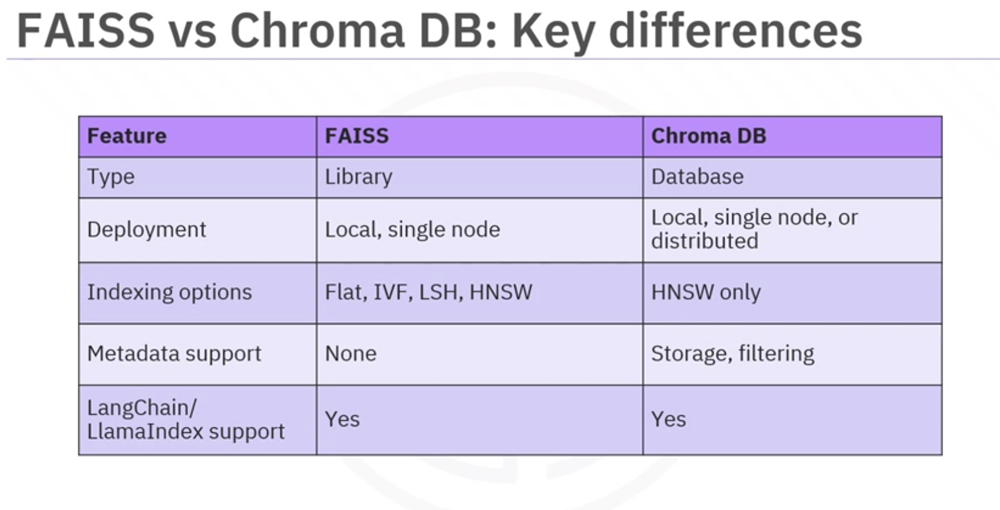
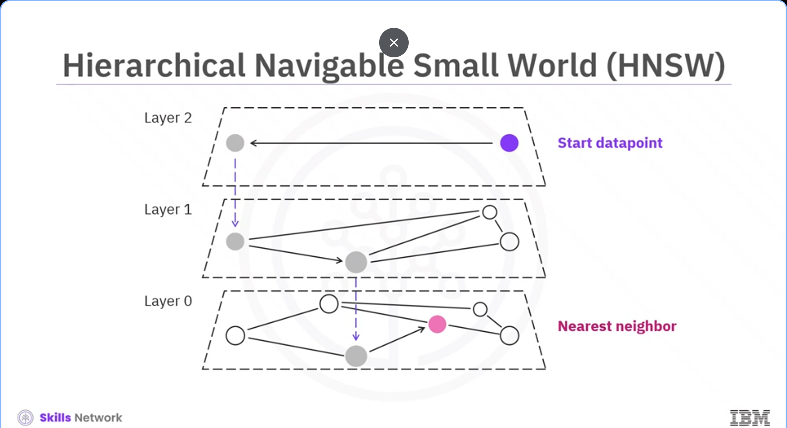
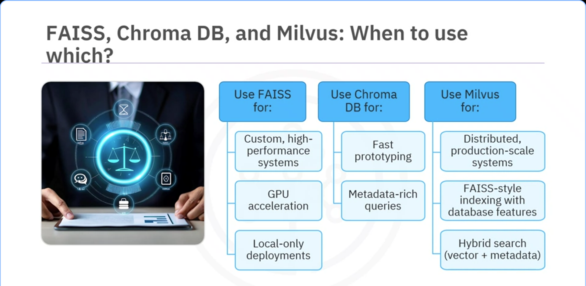

# FAISS Indexing, Search Algorithms & Milvus Integration

Comprehensive comparison between FAISS and ChromaDB, deep dive into high-performance vector indexing methods (Flat, IVF, LSH, HNSW), and extending FAISS with Milvus for enterprise scalability.

---

## Table of Contents

- [FAISS vs. ChromaDB: Overview & Comparison](#introduction-to-faiss)
  - [FAISS (Facebook AI Similarity Search)](#faiss---facebook-ai-similarity-search)
  - [ChromaDB](#chromadb)
- [FAISS Indexing Algorithms](#index)
  - [Flat Index (Exhaustive Search)](#flat-index)
  - [Inverted-File Index (IVF / Voronoi Clustering)](#inverted-file-index-ivf)
  - [Locality-Sensitive Hashing (LSH)](#locality-sensitive-hashing)
  - [Hierarchical Navigable Small World (HNSW)](#hierarchical-navigable-small-world-hnsw)
- [Extending FAISS with Milvus](#extending-faiss-with-milvus)
  - [Why Extend FAISS?](#extending-faiss-with-milvus)
  - [Milvus Capabilities (Metadata Filtering & Horizontal Scale)](#milvus)

---

## Introduction to FAISS

*Describe FAISS and chromadb*
*explain key difference between FAISS and chromadb*
*describe the indexes used by FAISS*
*explain the concepts of locality-sensitive hashing and hierarchical navigable small world*
*describe how to extend FAISS with Milvus*
*understand when to use FAISS or chroma db*

### FAISS - Facebook AI Similarity Search

lib made by meta for fast vector search
it runs on a single machine using cpu or gpu (either)
write code to use it, (no built in db or server)
great for custom and high performance

### Chromadb

*vectordb designed for AI applications*
*stores vectors and metadata*
*run locally or a server*
*easy to use and integrate with tools like langchain*

### Index

* helps search vectordb faster
* FAISS has several index types
* each balances
  * memory
  * speed
  * accuracy

#### Flat Index

* simplest method for searching the documents
* exhaustive linear scan of query with all the documents using similarity distances (cosine similarity, euclidean distance, or dot product)
* retrieve k-nearest vectors after ranking all the vectors
  * slow for large scales

#### Inverted-File Index (IVF)

* use clusters of the relevant vectors
  * Speeds up vector search using methods like (k-means)
  * forming voronoi cells around clusters
* each cell contains vectors closest to its centroid
* when a query vector is introduced, search is limited to the nearest cells to the centroid
* *Faster but reduces accuracy due to neighboring vectors might be put in another cell*

#### Locality-Sensitive Hashing

* Use hash functions to group similar vectors
* fast and memory efficient search
* query vector -> search in the closest matching hash
* best for -> high dimensional sparse data
  * text embeddings
* *Neither the fastest, nor the most accurate method*

#### Hierarchical-Navigable Small World (HNSW)

* organize vector in hierarchy of layers
* top layers are sparse and contain few vectors
  * top layer helps to get close to the target region
* graphs becomes denser as search descends to lower layer
* *Fast and accurate for large datasets*

### Extending FAISS with Milvus

* FAISS is powerful for local and high-performance vector search but it lacks features of metadata support and distributed scaling

#### Milvus

* Milvus, a vectordb uses FAISS as one of its core indexing engine and adds these missing capabilities (metadata, and scaling etc)
* Support storing and filtering metadata alongside vectors, enabling hybrid queries (i-e Find similar items under $50)
* Support distributed deployment and scalable

