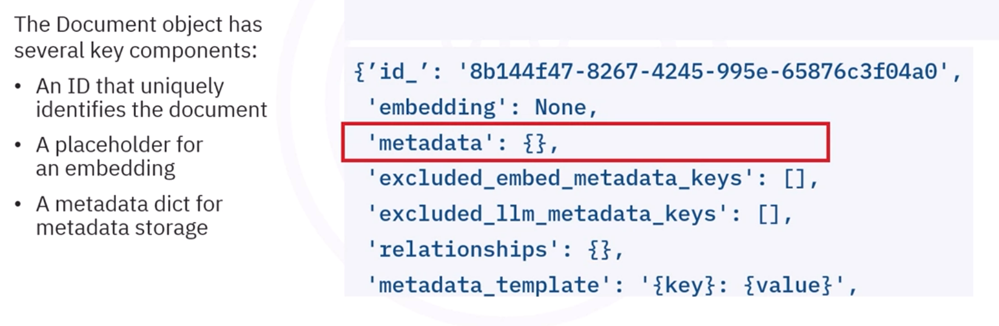
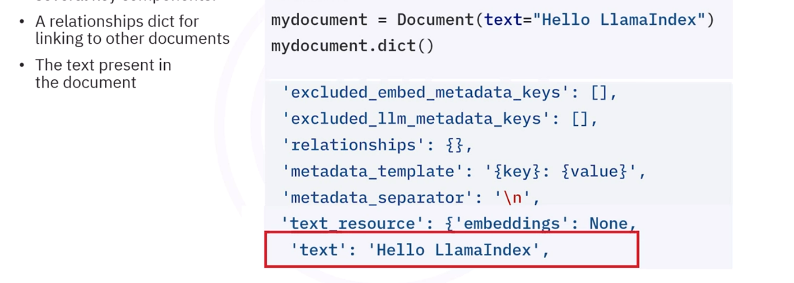

# LlamaIndex Document Ingestion & Chunking

Foundational concepts of context augmentation, data connectors, reading local documents with `SimpleDirectoryReader`, and token/sentence chunking into `Node` objects.

---

## Table of Contents

- [Introduction to LlamaIndex & RAG](#llamaindex)
- [Document Class & Connectors](#1---llamaindexdocument----generic-container-for-document-sources-)
  - [Code Example: Basic Document Object](#code-example)
  - [Loading Files with SimpleDirectoryReader](#load-files-from-simple-local-directory)
- [Node Abstraction & Text Chunking](#llamaindex-nodes)
  - [SentenceSplitter](#code-example-1)
  - [LangChain Parser Integration (LangchainNodeParser)](#categories-of-splitters)

---

**Describe LlamaIndex**
**Explain RAG and LlamaIndex in Context of AI Chatbots**
**Load Source Documents into LlamaIndex**
**Split Documents into chunks(nodes) using LlamaIndex**

* Framework for building **LLM-powered context augmentation**
    ** Context Augmentation
        == Adding **external knowledge** sources to **LLM-powered applications**
        == **Typical RAG**

**1 - LlamaIndexDocument - (* Generic container for document sources *)**
  *Loading **textual data** file indexes into the LlamaIndexDocument*
  *txt, pdf, markdown, csv, json, html*

* *`simple_fs` loader*
* *`simple_http` loader*
* *`simple_email` loader*
* *`simple_email` loader*
* *=> connectors for connecting with file services and data sources (databases, APIs, SaaS platforms)*

## Code Example

from llama_index.core import Document                 *Loading Document class*
mydocument = Document(text="Hello LlamaIndex")    *An instance of document class*
mydocument.dict()   *Items stored in the document object*




### Load Files from simple local directory 

*Import SimpleDirectoryReader*

```python
from llama_index.core import SimpleDirectoryReader
```

*Import all the files from the directory*

```python
documents = SimpleDirectoryReader("../data/\*\*"),load_data()   *All files from the directory*
```

**Parameters**

```python
*Import recursively from subdirectories (arguments)*
recursive=True   **default = False**
*Import specific files (arguments)*
inputFiles=["file1.txt","file2.txt"]    **default = None**
*Import specific file types (arguments)*
required_exts=[".txt","pdf","markdown"] **default = None**
```

### LlamaIndex Nodes

- *(Chunk of texts from the document)*
- *Chunking long indexes help in relevant embedding generation*
- *LlamaIndex Node represents a block of text*

## Code Example

*SentenceSplitter splits long text texts recursively based on specific characters, such as newline characters and periods*

```python
from llama_index.core.node_parser import SentenceSplitter   *import sentence splitter class*
node_parser = SentenceSplitter(chunk_size=1024, chunk_overlap=20) 
```

*chunk_size = how many tokens to process in one go, chunk_overlap = how many tokens to overlap between chunks*
*get_nodes_from_documents method to split documents into individual nodes*

```python
nodes = node_parser.get_nodes_from_documents(documents) **documents => fetched documents from SimpleDirectoryReader from llama_index.core**
```

**Categories of Splitters**
- SemanticSplitter => Split the chunk where the similarity falls below a certain threshold

```python
*Wrappers for langchain splitter*
from langchain.text_splitter import RecursiveCharacterTextSplitter
from llama_index.core.node_parser import LangchainNodeParser
```

```python
*Initialize Langchain Splitter instance*
langchain_splitter = RecursiveCharacterTextSplitter(
    separators=["\n\n", "\n", ".", " "],
    chunk_size=1024,
    chunk_overlap=20,
)
```

```python
*Wrap the splitter around llama_index wrapper*
parser = LangchainNodeParser(langchain_splitter)
```

```python
*Call the parser on the documents*
nodes = parser.get_nodes_from_documents(documents)  **documents => fetched documents from SimpleDirectoryReader from llama_index.core**
```
