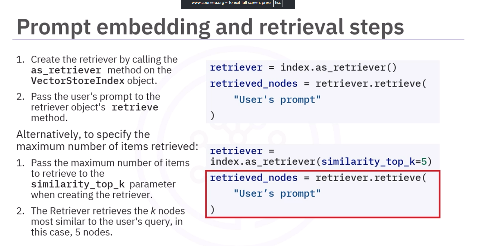
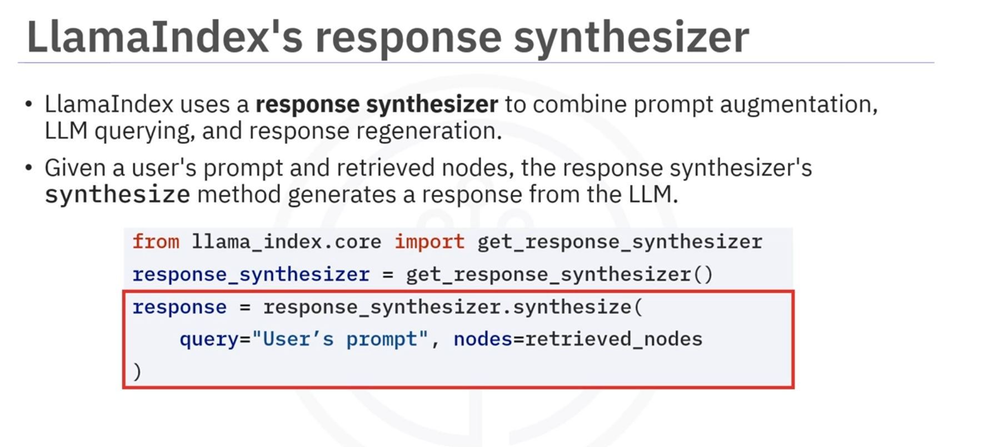
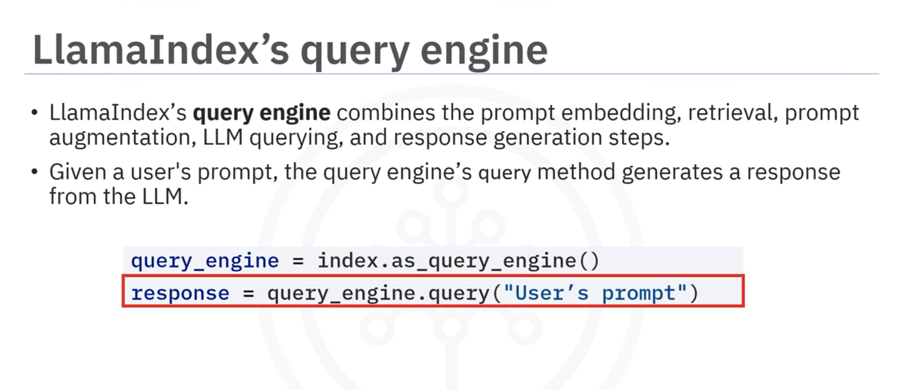

# LlamaIndex Vector Storage, Retrieval & Query Engines

End-to-end RAG architecture in LlamaIndex: generating embeddings, persistent storage with ChromaDB, similarity retrieval, response synthesis, and the unified Query Engine.

---

## Table of Contents

- [Vector Storage in LlamaIndex](#llamaindex-vector-storage)
- [Custom Embedding Models & ChromaDB Integration](#working-with-custom-libraries-and-opensource-models)
  - [HuggingFace Embeddings (`all-MiniLM-L6-v2`)](#working-with-custom-libraries-and-opensource-models)
  - [ChromaDB Vector Store & StorageContext](#sql-vs-vector-store-chroma-db)
- [Index Creation (`VectorStoreIndex`)](#pass-the-nodes-the-model-and-storage-context-to-vectorstoreindex-class-to-create-index)
- [Retrieval & Similarity Search (`as_retriever`)](#prompt-embeddings-and-retrieval-steps)
- [Response Synthesis (`get_response_synthesizer`)](#prompt-augmentation-and-llm-querying)
- [Unified Query Engine (`as_query_engine`)](#query-engine-one-in-all-going-forward)
- [Summary of Components](#summary)

---

- **Embedding and Vector Stores in LIamaIndex**
- **How to retrieve in LlamaIndex from vector stores**
- **Prompt Augmentation and LLM querying in LlamaIndex**
- **How LlamaIndex query engine combine several RAG steps into a single object**

*Generating embeddings with llama_index*

```python
from llama_index.core import VectorStoreIndex
index = VectorStoreIndex(nodes)   *VectorStoreIndex class is used to create an index from nodes => does embedding + stores in vector store (by default it use in-memory store).*
*nodes that were generated using the SentenceSplitter.node_parser.get_nodes_from_documents(documents)*
```

## Working with custom libraries and OpenSource models

*import necessary libraries*

```python
import chromadb
from llama_index.core import VectorStoreIndex, StorageContext
from llama_index.vector_stores.chroma import ChromaVectorStore
from llama_index.embeddings.huggingface import HuggingFaceEmbedding *Embedding Model from HuggingFace*
```

*define embedding model*

```python
embed_model = HuggingFaceEmbedding(model_name="sentence-transformers/all-MiniLM-L6-v2") *Custom embedding generator other than default of llama_index*
```

**Setup vector store and storage context**

*ChromaDB => stores embeddings which are vector representations of nodes, in a database*

```python
db = chromadb.PersistentClient(path="/tmp/chroma_db_test")
```

**SQL vs. Vector Store (chroma db)**

*SQL Database => Chroma Client Persistent storage*

*SQL TABLE => Chroma Collection*

*SQL ROW/Record => Chroma Document/Vector representation of a node*

```python
chroma_collection = db.get_or_create_collection("my_collection")    *instantiate or read a collection*
vector_store = ChromaVectorStore(chroma_collection=chroma_collection) *llama_index wrapper around for chromadb*
storage_context = StorageContext.from_defaults(vector_store=vector_store)   *storage object instance to use with llama_index*
```

### Pass the nodes, the model, and storage context to VectorStoreIndex class to create index

```python
index = VectorStoreIndex(nodes=nodes, embed_model=embed_model, storage_context=storage_context)     *nodes => Chunk of texts from the documents, embed_model => embedding model (custom -> huggingface in this case), storage_context => storage instance (chroma db in this case)*
```

*VectorStoreIndex => Performs the embeddings and stores them index/vector storage using a simple function pipeline*

### Prompt embeddings and retrieval steps

```python
retriever = index.as_retriever()    *Retriever object to perform retrieval from the index*
*Parameters*
    *similarity_top_k => number of nodes to retrieve (default = 2)*
    *vector_store_query_mode => 'default' -> cosine similarity, 'hybrid' -> BM25 + cosine similarity*
```

```python
retrieved_nodes = retriever.retrieve("User Prompt")  *User query is converted into an embedding using the same model for the indexing and compared with the embeddings of all the nodes in the vector store (chroma db in this case). Cosine similarity is then evaluated and top k chunks are returned (default k = 2)*
```




### Prompt augmentation and LLM querying

*Llama_index has a pipelined method that works all in from user querying to the end result from the llm*

``` python
from llama_index.core import get_response_synthesizer
response_synthesizer = get_response_synthesizer()
response = response_synthesizer.synthesize(query="User's Prompt", nodes=retrieved_nodes)    *querying of the nodes with user prompt, augmentation of the top k nodes and the querying the llm is handled by the get_response_synthesizer().synthesize() function in the background* 
```



#### Query Engine (One in all going forward)

*QueryEngine object encapsulates all the RAG steps such as retrieval from the index, prompt augmentation, llm querying, and response generation(synthesize) steps from one function call*

```python
query_engine = index.as_query_engine()
response = query_engine.query("User's Prompt")    *query_engine.query() method handles all in from user querying to the end result from the llm*
```



#### Summary

*VectorStoreIndex class for embedding generation and storage*

*Retriever on the StoreIndex is achieved through **as_retriever** method on VectorStoreIndex object. Pass the user prompt to the retriever.retrieve() function to get the relevant results*

*ResponseSynthesizer() class's **synthesize()** method is used to get the final result from the LLM after prompt augmentation*

*We can customize the response synthesizer response using different LLMs and prompt templates*

*query_engine is a single object that handles prompt_embedding, retrieval, prompt_augmentation, llm querying, and synthesizing (response generation) into a single function call*
